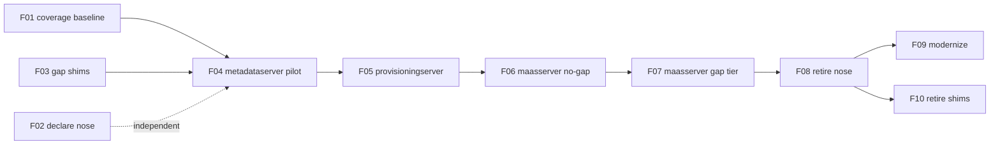

# Product Plan: Coverage-gated pytest cutover

> Status: Approved
> Supersedes: the F01-F07 feature map of the previous `PLAN.md` (plugin-first
> approach, abandoned — no code landed)
> Source Idea: @.ai/sdd/ideas/003-coverage-gated-pytest-cutover.md

## Vision

MAAS gates every merge on two test runners: `nose` (496 legacy test files,
12,921 tests, run via `bin/test.parallel`) and `pytest` (381 files, 4,085
tests under `src/tests/`). `nose` is unmaintained and — critically — not even
declared in `pyproject.toml` while being imported by `maastesting/noseplug.py`.
This plan retires nose and the legacy stack (`testtools`, `testscenarios`,
`testresources`) by moving every test under `src/tests/` and gating each
package on **branch coverage parity measured by `coverage.py`**, which
licenses deleting redundant legacy tests rather than porting all of them.
Because Django and Twisted are themselves scheduled for removal (~1 year),
the plan deliberately builds the smallest possible compatibility surface.

## Steering Context

- Product: @.ai/steering/product.md
- Tech Stack: @.ai/steering/tech-stack.md
- Conventions: @.ai/steering/conventions.md
- Principles: N/A
- Source Idea: @.ai/sdd/ideas/003-coverage-gated-pytest-cutover.md

## Personas

- **MAAS engineer:** writes and runs region/rack tests daily; needs one
  runner, fast feedback, and idiomatic fixtures instead of nose-specific
  quirks and a split test layout.
- **CI maintainer:** owns the merge gate; needs a single suite, coverage
  attributable per package, and no ambient undeclared dependencies.

## Evidence Base

All figures verified 2026-11-16 against the live `.ve` (Python 3.14.4,
pytest 9.2.0), not inferred. Full method in the source idea.

| Package | Legacy files | Test defs | Touches ≥1 gap | Touches none |
|---------|-------------|-----------|----------------|--------------|
| `provisioningserver` | 129 | 2,733 | 58 | 71 |
| `metadataserver` | 23 | 927 | 9 | 14 |
| `maasserver` | 338 | 9,248 | 141 | 197 |
| **Total** | **490** | **12,908** | **208** | **282** |

(`src/perftests`'s 6 files are already pytest-native via `make test-perf`
and are out of scope.)

**Exactly three gaps separate legacy tests from stock pytest.** Identified
empirically by running real unmodified files:

1. **Scenarios** — `testscenarios` attributes never applied; symptom
   `AttributeError: 'TestX' object has no attribute 'name'`. 54 `maasserver`
   files.
2. **Reactor/crochet** — reactor never started; symptom
   `AttributeError: 'Deferred' object has no attribute 'wait'`. 49
   `maasserver` files.
3. **`APITestCase` base** — `maasserver/testing/api.py:158` computes
   scenarios per-instance in `__init__`, so pytest collects the abstract base
   whose `userfactories` is `None`; symptom `TypeError: 'NoneType' object is
   not iterable` **at collection time**, which aborts the whole file. 61
   files. This is a **one-file source fix**, not a plugin.

**Proven to need zero machinery:** a 20-file sample from the no-gap tier ran
`361 passed in 10.14s` with no MAAS plugins and no source edits. A
`MAASServerTestCase` file — the class the previous approach treated as a
blocker — passes plugin-free in 4.06s. `MAASServerTestCase` is *not* a gap.

## MVP Boundary

### Must Have

- A per-package branch-coverage baseline captured before any test moves.
- The three gaps closed by the smallest viable means: a minimal
  `conftest.py`-level shim for scenarios and reactor, plus the one-file
  `maasserver/testing/api.py` fix.
- `provisioningserver` and `metadataserver` fully cut over to pytest, living
  under `src/tests/`, meeting or exceeding their coverage baseline.
- `nose` declared explicitly in `pyproject.toml` while it still runs, so the
  gate stops depending on an ambient install.

### Won't Have Yet

- Rewriting passing legacy tests into idiomatic fixtures purely for style —
  relocation is mechanical; modernization is opportunistic (idea D-003).
- Adopting `pytest-django` — open decision, likely not worth it given
  Django's removal.
- Touching `src/maasui` or Go suites.
- Any performance target for the migrated suite beyond "CI completes".

## Feature Map

### Phase 1 — MVP (Must Have)

| ID | Feature | Module | Description |
|----|---------|--------|-------------|
| F01 | Coverage baseline harness | `utilities`, CI | Make `utilities/run-tests-coverage` produce a reliable **per-package** branch-coverage baseline and record it as the comparison artifact. Resolve the `maas-openfga-migrator` build prerequisite that currently blocks a local `bin/test.region` run. |
| F02 | Declare `nose`, close the ambient-dependency hole | `pyproject.toml` | Add `nose` to `optional-dependencies.testing` so the suite is honest for as long as nose runs. Independent of migration; fixes a latent CI break today. |
| F03 | Minimal gap shims | `maastesting`, `src/tests/conftest.py` | One small conftest-level shim providing `testscenarios` application and reactor/crochet session setup, plus the one-file `maasserver/testing/api.py` metaclass fix. Explicitly **not** a port of nose's `OptimisingTestSuite`. |
| F04 | Cut over `metadataserver` (pilot) | `metadataserver` | Smallest package (23 files, 9 gap-touching). Relocate to `src/tests/metadataserver/`, triage the gap tier, drop from nose, prove coverage parity. Validates the whole method end-to-end at low cost. |
| F05 | Cut over `provisioningserver` | `provisioningserver` | 129 files, 71 gap-free. Heaviest Twisted usage, no Django — exercises the reactor shim at scale. |

### Phase 2 — Essentials (Should Have)

| ID | Feature | Module | Description |
|----|---------|--------|-------------|
| F06 | Cut over `maasserver` (no-gap + gap tiers merged) | `maasserver` | **Done (spec 009).** The planned 197/141 two-tier split was based on a grep partition that proved obsolete: F03's `legacy.py` shim covers scenarios and crochet generically, and `testresources` usage is zero. Measured partition instead: 332 clean files relocated (mechanical), 4 mixed files split at class level, 2 legacy-only files left. The only real carve-out is the 9 legacy classes (idea 002 gap-3). |
| F07 | Residual `maasserver` legacy carve-out | `maasserver` | **Closed by spec 010.** F06 left the 10 `legacy`-tagged classes (incl. metadataserver's `TestBinaryField`) under nose (idea 002's `MAAS_PREVENT_MIGRATIONS` gap-3). Spec 010 runs them under pytest with `MAAS_PREVENT_MIGRATIONS=1` + a Django-migrate DB, so the carve-out no longer requires nose. |
| F08 | Retire the nose test runner | `maastesting`, `Makefile`, `pyproject.toml`, CI | **Done.** Deleted the runner machinery (`scripts.py`, `noseplug.py`, `djangoloader.py`, `parallel.py`, `_nose_compat.py`, their tests), the `nose` and `testresources` deps, and the 4 `test.*` entry points; migrated the last consumers off nose (`testcase.py`, `test_machine.py`) and off `testresources` (new self-contained `maastesting/resources.py`); updated the migration-gate tools (`run-tests-coverage`, `coverage-baseline`) to invoke the dedicated pytest legs. **Scope correction from the original plan:** `testtools` (base of 227 test files), `testscenarios` (91 test files), and `djangotestcase.py` (legacy base + query-counting utils for 26 files) are still load-bearing and were *not* removed — their removal is F09/F10-scale work, not a runner retirement. Verified: 22408 passed / 6 failed (all pre-existing), both dedicated legs green (1850/1850 rack, 69 region-legacy). |

### Phase 3 — Nice to Have (Could Have)

| ID | Feature | Module | Description |
|----|---------|--------|-------------|
| F09 | Modernize relocated tests to fixtures | `src/tests` | Opportunistic conversion of `MAASTestCase` subclasses to plain pytest functions/fixtures and scenarios to `parametrize`. **Hard prerequisite (verified F08):** `pytest.mark.parametrize` does NOT inject args into `unittest.TestCase` subclass methods (both class- and method-level raise `TypeError: missing 1 required positional argument`; it only works on plain pytest classes). So `testscenarios` → `parametrize` is *not* a find-replace — every test must first be converted off `unittest.TestCase` (the MAASTestCase → testtools.TestCase → unittest.TestCase chain) to plain pytest, losing its setUp/tearDown/testtools infrastructure. This is the bulk of the work; `testscenarios` (91 files) and `testtools` (227 files) both gate on it, so they are F09/F10 programs, not runner retirements. Value drops sharply as Django/Twisted removal nears. |
| F10 | Retire the shims | `maastesting` | Once Django/Twisted are gone, delete F03's shims and any remaining `maastesting` runner machinery. Note: F08 already retired `nose` + `testresources` and the runner machinery; what remains here is `testscenarios`, `testtools`, `djangotestcase.py`, and the F03 `legacy.py` shim — all gated on F09's `unittest.TestCase` conversion. |

## Dependencies

Real sequencing constraints only:

- **F01 before any cutover** — without a baseline there is no gate, and the
  whole method collapses into guesswork.
- **F03 before F04** — the pilot needs the shims to be meaningful; closing
  the gaps on 9 files first makes the shim design cheap to iterate.
- **F04 before F05 before F06/F07** — ascending size and risk, so the method
  is proven on 23 files before it is trusted on 338.
- **F06 before F07** — bulk the easy 197 first; the hard 141 benefit from a
  settled layout and a proven shim.
- **F08 after all cutovers** — nose cannot be removed while any package
  still runs on it.
- **F02 is independent** and can land immediately.

## Risks

| Risk | Impact | Mitigation |
|------|--------|------------|
| Branch coverage holds while a behavioural edge case is silently lost (a scenario-multiplied test replaced by a single-path equivalent keeps lines green but tests less) | High | Require scenario-derived deletions to name the specific existing test that covers the case; do not accept "coverage is green" alone for scenario or reactor tests. |
| The coverage baseline itself is untrustworthy (local vs CI hardware, flaky tests, the `maas-openfga-migrator` prerequisite) | High | F01 is a dedicated feature, not a side task; baseline must be reproducible twice before it gates anything. |
| F03's "minimal shim" grows into the F02/F03 plugin that already failed twice | Medium | Hard scope rule: the shim closes the three *identified* gaps only. A fourth gap triggers a stop-and-reassess, not an extension. |
| `maasserver`'s 141-file gap tier hides further gaps not visible to grep | Medium | F06 lands first and will surface collection-time errors early; F07 begins with a full collection-only run (`--collect-only`) across all 338 files before any triage. |
| Deleting legacy tests removes the only coverage of a FIPS/STIG-hardening path | Medium | Treat FIPS/hardening-related tests as non-deletable; port or keep them regardless of duplication. |
| Dual-layout period confuses engineers mid-migration | Low | Per-package cutover keeps each package wholly in one place; no package is ever half-moved at rest. |
| Removing `testtools` breaks non-test code | Low | `grep` for imports outside test trees before F08; `maastesting/__init__.py` imports `testtools.content` today. |

## Open Decisions

- **Coverage baseline fidelity:** must the baseline be captured on CI
  hardware, or is a reproducible local `utilities/run-tests-coverage` run
  sufficient? Blocks F01's acceptance criteria.
- **`pytest-django`:** adopt it, or keep the hand-rolled
  `maastesting/pytest/django.py`? Leaning keep-hand-rolled given Django's
  removal, but F04 is the cheapest place to test the question.
- **Coverage threshold shape:** exact parity per package, or a small
  tolerance band (e.g. −0.5pp) to absorb measurement noise? Needs deciding
  in F01 before it gates F04.
- **Who adjudicates deletion:** does "coverage already duplicated" need
  reviewer sign-off per file, or is the coverage number self-certifying?
- **Interim nose declaration:** does F02 pin a specific `nose` version, given
  it is unmaintained and currently satisfied by a system `dist-packages`
  install?
- **`src/tests/maastesting/test_noseplug.py`** tests the very plugin F08
  deletes — confirm it is deleted with it rather than ported.

## Next Step

After approval, create `requirements.md` for **F01 (coverage baseline
harness)** — it gates every subsequent cutover and carries the unresolved
threshold/fidelity decisions.
