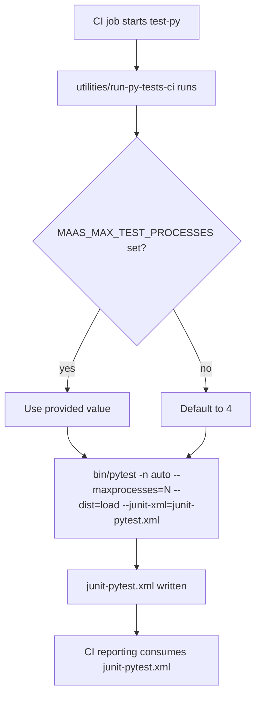

# Design: pytest-xdist parallel infra
> Requirements: @requirements.md
> Status: Approved

## 1. Summary

Formalize and document the pytest-xdist invocation pattern that already
runs in CI today (`utilities/run-py-tests-ci`), close the gap between what
the script does and what the requirements/docs say, and validate it
against the existing pytest-native suite (`src/tests/**`, 381 test files)
before F03–F06 plug migrated nose suites into it. No new orchestration
code is introduced; this is a verification, documentation, and
small-amendment pass over existing infrastructure.

## 2. Requirements Mapping

| Requirement | Design Coverage |
|-------------|-----------------|
| FR-001 | §3 Technical Approach, §6 (existing `MAAS_MAX_TEST_PROCESSES` → `--maxprocesses` wiring in `utilities/run-py-tests-ci`) |
| FR-002 | §13 TD-001 (default stays fixed `4`, matches current script; requirements amended) |
| FR-003 | §6 (existing `--junit-xml=junit-pytest.xml` output, already consumed by CI) |
| FR-004 | §15 Verification Strategy (validation run against `src/tests/**`) |
| NFR-001 | §15 Verification Strategy (timing comparison) |
| NFR-002 | §15 Verification Strategy (flakiness check via repeated run) |

## 3. Technical Approach

`utilities/run-py-tests-ci` already implements the required pattern:

```bash
MAX_PROCESSES=${MAAS_MAX_TEST_PROCESSES:-4}
bin/pytest -n auto --maxprocesses="${MAX_PROCESSES}" --dist=load \
    --junit-xml=junit-pytest.xml
```

- `-n auto --maxprocesses=N` caps worker count at `N` while letting xdist
  pick up to that many based on CPU availability (FR-001/FR-002).
- `--junit-xml=junit-pytest.xml` satisfies FR-003.
- `--dist=load` distributes test items dynamically across workers
  (standard xdist load balancing).

No code change is required to satisfy FR-001–FR-003; they already exist.
Work for F01 is:

1. Confirm `--maxprocesses` + `MAAS_MAX_TEST_PROCESSES` is the single
   source of truth for worker count (no competing config).
2. Run and record a validation pass of the existing pytest-native suite
   (`src/tests/**`, `testpaths = ["src/tests"]`) under this invocation to
   confirm FR-004.
3. Capture a timing baseline for NFR-001 (current combined runtime) to
   compare against once F03–F06 land.
4. No design or code changes to `test.parallel`/`noseplug.py` — they are
   untouched until F03–F06/F07.

## 4. Component / Module Structure

```text
utilities/run-py-tests-ci     # existing CI entrypoint; unchanged structure
  MAX_PROCESSES (env-driven)  # already reads MAAS_MAX_TEST_PROCESSES
  bin/pytest -n auto ...      # already wired with --maxprocesses, --dist=load, --junit-xml
```

No new modules, services, or plugins. `maastesting.pytest.*` entry points
(`maas-database`, `maas-django`, `maas-environment`, `maas-perftest`,
`maas-seeds`, `maas-sqlalchemy`) are untouched — out of scope for F01.

## 5. Data Model / State

Not applicable.

## 6. API / Integration Contract

- **Input:** `MAAS_MAX_TEST_PROCESSES` env var (optional; default `4`),
  read by `utilities/run-py-tests-ci`.
- **Output:** `junit-pytest.xml` at repo root, JUnit XML format, produced
  by `pytest`'s built-in `--junit-xml` flag (not a custom writer) —
  consumed by existing CI JUnit reporting without translation (satisfies
  US-002's "no separate translation step" criterion, since it's native
  pytest JUnit output, unlike nose's path which goes through
  `subunit-1to2` → `subunit2junitxml`).

## 7. Security / Permissions / Privacy

Not applicable.

## 8. User Flows



## 9. Edge Cases

| Case | Expected Behavior |
|------|-------------------|
| `MAAS_MAX_TEST_PROCESSES` set to a non-integer | Shell arithmetic/`--maxprocesses` parse fails; pytest-xdist reports an error and exits non-zero (existing behavior, unchanged). |
| `MAAS_MAX_TEST_PROCESSES=1` | Runs effectively serial under xdist (1 worker); valid, no special-case needed. |
| No tests collected under `src/tests` (misconfigured `testpaths`) | pytest exits non-zero ("no tests ran"); existing behavior, not altered by F01. |
| Local developer runs bare `bin/pytest` | Runs single-process, no parallelism — accepted per design clarification (`make test-py` is the documented parallel entrypoint). |

## 10. Accessibility / UX Notes

Not applicable.

## 11. Observability / Operations

- `junit-pytest.xml` remains the operational artifact CI dashboards read;
  no new logs/metrics introduced.
- **Performance baseline (recorded 2026-11-13):** `MAAS_MAX_TEST_PROCESSES=4
  bin/pytest -n auto --maxprocesses=4 --dist=load src/tests` — 202.62s
  pytest-internal time (209.89s wall-clock), 7949 tests collected (7766
  passed, 2 failed — pre-existing, unrelated — 181 skipped). Re-run with
  `MAAS_MAX_TEST_PROCESSES=2`: 381.26s (consistent 2x scaling). This is
  the "before" baseline F06's NFR-001 completion check (full F01–F06
  end-state, ~10% ceiling) compares against. Re-measure immediately
  before F06's final check per design.md §14 risk mitigation, since
  hardware/CI runner conditions may drift.

## 12. Migration / Rollout

Not applicable — no suites move in F01; `utilities/run-py-tests-ci`'s
pytest invocation already runs in production CI today. Nothing to roll
out or roll back.

## 13. Technical Decisions

### TD-001: Keep existing fixed default of 4 workers, amend requirements instead of code

- **Decision:** `MAAS_MAX_TEST_PROCESSES` default stays `4` (current
  `utilities/run-py-tests-ci` behavior). FR-002/US-001 were amended to
  describe this actual default rather than nose's historical
  cores-minus-2 convention.
- **Why:** The existing default is already proven stable in production
  CI; changing it carries risk (CI runner resource contention) with no
  clear benefit, since `--maxprocesses` already caps worker count
  independent of local core count.
- **Trade-off:** Local developer machines with very different core counts
  don't get an auto-scaled default; they must set
  `MAAS_MAX_TEST_PROCESSES` explicitly for anything other than 4 workers.
- **Alternatives considered:** Change the script's default to
  `max(os.cpu_count() - 2, 2)` to match nose exactly — rejected per user
  decision (requirements amended instead).

### TD-002: No new scenario/resource plugin work in this feature

- **Decision:** F01 only validates the xdist/JUnit pattern against
  already-pytest-native suites (`src/tests/**`); it does not touch
  `testscenarios`/`testresources`-based tests still living under nose
  (`src/maasserver/**/tests`, `src/provisioningserver/**/tests`).
- **Why:** Those suites aren't pytest-collectible yet; validating xdist
  against them is meaningless until F02 (scenario plugin) and F03–F05
  (module migrations) land.
- **Trade-off:** F01's "done" signal is narrower than the plan's original
  phrasing ("replace test.parallel") — scoped down per D-001 in
  requirements.md.
- **Alternatives considered:** Attempt a spike migrating one nose test
  file early to validate end-to-end — rejected; out of scope per
  requirements, would blur F01/F03 boundaries.

## 14. Risks

| Risk | Impact | Mitigation |
|------|--------|------------|
| Timing baseline measured now becomes stale by the time F06 completes (hardware/CI runner changes) | Low | Re-measure baseline immediately before F06's final NFR-001 check, not just once in F01. |
| `--dist=load` behavior change in a future `pytest-xdist` minor version | Low | Dependency already pinned (`pytest-xdist>=3.8,<3.9`); no action needed now. |
| Someone assumes F01 "replaces test.parallel" literally (per PLAN.md wording) and expects nose suites gone | Medium | D-001 in requirements.md and TD-002 here make the scope explicit; communicate in PR description. |

## 15. Verification Strategy

- **Validation run (FR-004):** Execute
  `MAAS_MAX_TEST_PROCESSES=4 bin/pytest -n auto --maxprocesses=4 --dist=load --junit-xml=junit-pytest.xml src/tests`
  and confirm exit code `0` (or expected failures only) and that
  `junit-pytest.xml` is well-formed and contains all collected test
  results.
- **Concurrency override (FR-001):** Re-run with
  `MAAS_MAX_TEST_PROCESSES=2` and confirm `ps`/xdist worker count reflects
  the override (e.g. via `--maxprocesses=2` visibly capping workers in
  verbose output).
- **JUnit output (FR-003):** Parse `junit-pytest.xml` and confirm it is
  valid XML with `<testsuite>`/`<testcase>` elements matching the number
  of tests collected.
- **Performance baseline (NFR-001):** Record wall-clock time of the
  validation run; this becomes the "before" baseline that F06's
  completion check compares against (end-to-end, not enforced in F01
  alone, since no suites have migrated yet).
- **Reliability (NFR-002):** Run the validation twice; confirm identical
  pass/fail counts both times (no flaky collection/distribution
  artifacts).
- **Lint/build:** `make lint` (per AGENTS.md); no new files requiring
  lint beyond doc/requirements amendments.

## 16. Implementation FAQ

**Q:** Does F01 require any code changes at all?
**A:** Likely none to `utilities/run-py-tests-ci` or `pyproject.toml` —
the pattern already exists. F01's deliverable is the validation run
(§15), the timing baseline record, and the requirements amendment
already made. If the validation run surfaces a real gap (e.g. JUnit
output malformed for some edge case), fix it then; don't pre-emptively
rewrite working CI config.

**Q:** Why does `--maxprocesses` exist alongside `-n auto` — isn't that
redundant?
**A:** `-n auto` tells xdist to auto-detect available CPUs, but
`--maxprocesses` caps the upper bound regardless of what `auto` detects
— this is how the configurable-override requirement (FR-001) is
satisfied without hand-rolling worker-count logic.

**Q:** Where does the "cores minus 2" convention go, since it's no longer
required?
**A:** It remains exclusively nose's historical convention in
`maastesting/parallel.py`, which is retired in F07. It is not carried
forward into the pytest path.
