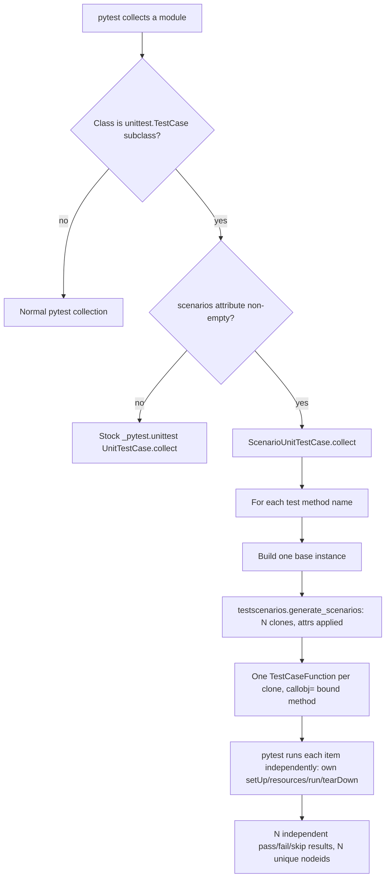

# Design: Scenario/resource pytest plugin

> Status: Approved

## 1. Summary

Two independent findings drive this design, both confirmed empirically
against real MAAS code (not just theory):

1. **Resource lifecycle (FR-002) needs no new plugin code.**
   `MAASTestCase.setUp()`/`tearDown()` already call
   `testresources.setUpResources`/`tearDownResources` unconditionally —
   this path is nose-independent and already works correctly under
   plain pytest. Verified with a throwaway resource-only test class run
   directly under `bin/pytest`: passed with correct resource lifecycle.
   The *only* loss is nose's `OptimisingTestSuite` suite-level
   pre-reservation optimization, which reduces resource rebuild
   frequency; without it, every test does a full build+clean cycle
   instead of reusing a resource across adjacent tests. This is a
   **documented performance finding** (D-001/US-004), not a correctness
   gap — see §11.

2. **Scenario expansion (FR-001) is broken under pytest today, and must
   be fixed at collection time, not left to run naturally.** A
   throwaway spike proved that `testscenarios`' runtime expansion
   (`WithScenarios.__call__` → `generate_scenarios` → `apply_scenario`'s
   `copy.copy`) collides with pytest's own unittest-integration method
   patching (`TestCaseFunction.runtest`'s
   `setattr(testcase, self.name, self.obj)`): the shallow copy carries
   over a bound method still pointing at the *original*, un-scenario'd
   instance, so **the first scenario attribute access throws
   `AttributeError`** — confirmed with a minimal 3-scenario reproduction.
   The fix is a `maastesting.pytest.scenarios` plugin that intercepts
   collection (`pytest_pycollect_makeitem`) for any
   `unittest.TestCase` subclass with a non-empty `scenarios` attribute,
   and returns a custom `UnitTestCase` subclass whose `collect()` yields
   one clean `TestCaseFunction` per scenario — each built via
   `testscenarios.generate_scenarios` and wired in with pytest's
   `callobj=` constructor parameter (bypassing the lazy-`_getobj`/
   method-patching path entirely, so the bug above cannot recur).
   **Validated against a real, currently nose-run file**
   (`src/maasserver/dhcpd/tests/test_config.py`, 30 methods × up to 3
   scenarios): 53 tests pass under both nose (today's baseline) and
   pytest with this plugin — identical count, identical outcomes, zero
   source changes to the test file.

## 2. Requirements Mapping

| Requirement | Design Coverage | Notes |
|-------------|-----------------|-------|
| FR-001 | §3 Technical Approach (scenario expansion), §4 (`maastesting.pytest.scenarios` module), §15 (real-file validation) | New plugin code |
| FR-002 | §3 Technical Approach (resource lifecycle), TD-002 | **No new code** — already works via `MAASTestCase` |
| FR-003 | §3 Technical Approach (automatic detection via `pytest_pycollect_makeitem`'s `scenarios` attribute check) | |
| FR-004 | §15 Verification Strategy (synthetic + real-file validation) | |
| FR-005 | §9 Edge Cases (combined scenario+resource), §15 | Verified empirically; no extra code — each scenario clone goes through normal `MAASTestCase.setUp()` |
| NFR-001 | §15 Verification Strategy (repeat-run reliability check) | |
| NFR-002 | §11 Observability/Operations (xdist/resource-reuse finding recorded) | |

## 3. Technical Approach

### Resource lifecycle (FR-002) — no new code

`MAASTestCase.setUp()` calls `self.setUpResources()`
(`testresources.setUpResources(self, self.resources, ...)`) and
registers `self.addCleanup(self.tearDownResources)` unconditionally,
regardless of test runner. `TestResourceManager.getResource()`/
`finishedWith()` track a use-count (`_uses`) on the manager instance
itself (a class-level attribute shared across test instances within one
process), so correctness does not depend on suite ordering — only
*efficiency* does. Nose's `Resources` plugin wraps the test suite in
`OptimisingTestSuite`, whose `run()` does a suite-level resource
pre-reservation (`getResource()` before running member tests,
`finishedWith()` only when switching to a resource set that no longer
needs it) — this is where reuse actually comes from. Plain pytest
collection has no equivalent suite-level reservation, so every test
gets a fresh build+clean cycle. Confirmed by spike: a resource class
with a build-counting manager showed 1 build per test (0% reuse) under
plain pytest, vs. nose's documented reuse across adjacent tests sharing
a resource. This is purely a performance characteristic — see §11 and
D-001 (out of scope to fix in F02).

### Scenario expansion (FR-001) — new plugin required

**Why run-time expansion doesn't work under pytest:**
`MAASTestCase` inherits `WithScenarios` ahead of `testtools.TestCase` in
its MRO, so `testcase(result=self)` (what pytest's
`TestCaseFunction.runtest()` calls) reaches
`WithScenarios.__call__` → `run()` → `generate_scenarios(self)` →
`apply_scenario` → `testtools.testcase.clone_test_with_new_id` →
`copy.copy(test)`. This is a **shallow** copy: it copies `test.__dict__`
verbatim, including the bound-method instance attribute that
`TestCaseFunction.runtest()` sets just before calling
(`setattr(testcase, self.name, self.obj)`) to support pytest's
tracing/pdb wrapping. That bound method stays bound to the *original*
instance. Each scenario clone's test method call therefore executes
against the original instance, not the clone — so scenario attributes
(set only on the clone) are never visible, and the **first** scenario
access throws `AttributeError`. This reproduces with a minimal 2-line
scenario class and is independent of resources, Django, or any other
MAAS-specific complexity — it is a structural incompatibility between
testscenarios' clone-based runtime expansion and pytest's unittest
integration.

**The fix — expand at collection time:**

```python
# maastesting/pytest/scenarios.py

@pytest.hookimpl(tryfirst=True)
def pytest_pycollect_makeitem(collector, name, obj):
    if not (isinstance(obj, type) and issubclass(obj, unittest.TestCase)):
        return None
    if not getattr(obj, "scenarios", None):
        return None
    return ScenarioUnitTestCase.from_parent(collector, name=name, obj=obj)


class ScenarioUnitTestCase(_pytest.unittest.UnitTestCase):
    def collect(self):
        cls = self.obj
        loader = unittest.TestLoader()
        for test_name in loader.getTestCaseNames(cls):
            base_instance = cls(test_name)
            for clone in testscenarios.generate_scenarios(base_instance):
                clone.scenarios = None  # prevent re-expansion
                scenario_id = clone.id().rsplit("(", 1)[-1][:-1]
                yield _pytest.unittest.TestCaseFunction.from_parent(
                    self,
                    name=f"{test_name}[{scenario_id}]",
                    callobj=getattr(clone, test_name),
                )
```

Key implementation points, each verified by spike:

- `tryfirst=True` on `pytest_pycollect_makeitem` lets this hook run
  before `_pytest.unittest`'s own `pytest_pycollect_makeitem` (both are
  `firstresult` hooks — first non-`None` wins); classes with no
  `scenarios` return `None` and fall through to pytest's stock unittest
  collection unchanged (confirmed: F01's `src/tests/**` validation never
  touched this hook, and it must keep working identically).
- The returned collector must be a `UnitTestCase` subclass (not a bare
  `Function`/`Class`), because `TestCaseFunction.runtest()` asserts
  `isinstance(self.parent, UnitTestCase)` for its skip-handling logic
  (`_is_skipped(self.parent.obj)`). A flat `Module > Function` hierarchy
  was tried first and failed this assertion.
- `callobj=` is the critical parameter: passed directly to
  `TestCaseFunction.from_parent`/`Function.__init__`, it sets
  `self._obj`/`self._instance` immediately, bypassing the lazy
  `instance` property (which only works for a `Class`-typed parent) and
  `_getobj`'s `getattr(parent_obj, self.originalname)` attribute lookup
  entirely (which would otherwise need the clone instance pre-attached
  before construction, and `own_markers.extend(get_unpacked_marks(self.obj))`
  inside `Function.__init__` accesses `self.obj` eagerly, too early for
  a post-construction attribute assignment to work).
- `originalname` must **not** be passed. Passing it as `test_name`
  (without the scenario suffix) makes `Function.__init__` compute
  `base_name = originalname or name` for nodeid construction, producing
  **duplicate nodeids** across scenarios (confirmed by spike: 3
  identical `test_value` nodeids where 3 unique ones were needed for
  JUnit XML `<testcase>` uniqueness, per F01's established
  `tests="N"` ↔ `<testcase>` count invariant). Omitting it lets `name`
  (which includes `[scenario_id]`) drive the nodeid directly, since
  `callobj=` already makes `originalname`'s attribute-lookup role moot.
- `clone.scenarios = None` (already set by
  `testscenarios.generate_scenarios` on its yielded clones) prevents the
  clone's own eventual `run()`/`__call__` from re-expanding — needed
  because `WithScenarios.__call__` still checks `_get_scenarios()`
  before falling through to testtools' normal `run()`.

## 4. Component / Module Structure

```text
maastesting/pytest/
  scenarios.py          # NEW — pytest_pycollect_makeitem hook,
                         # ScenarioUnitTestCase collector
  django.py              # unchanged
  database.py            # unchanged
  environment.py          # unchanged
  perftest.py             # unchanged
  seeds.py                # unchanged
  sqlalchemy.py           # unchanged

maastesting/testcase.py   # unchanged — MAASTestCase's existing
                           # setUpResources/tearDownResources already
                           # satisfies FR-002, no edits needed

pyproject.toml
  entry-points.pytest11.maas-scenarios = "maastesting.pytest.scenarios"  # NEW
```

No other module changes. `maastesting/noseplug.py`,
`maastesting/scenarios.py` (`WithScenarios`), and
`maasserver/testing/resources.py` are untouched — nose's path keeps
working exactly as today (D-001 in requirements.md: nose is not
retired by this feature, same as F01's scope boundary).

## 5. Data Model / State

Not applicable. No persistence; collection-time, in-memory test-item
generation only.

## 6. API / Integration Contract

- **Input:** A test class's existing `scenarios` class attribute
  (sequence of `(name, {attr: value, ...})` tuples) — MAAS's existing
  convention, read-only, no new declaration syntax.
- **Output:** One pytest test item (`TestCaseFunction`) per scenario,
  nodeid `<module>::<class>::<method>[<scenario_name>]`, each reporting
  its own independent pass/fail/skip/error outcome to pytest's result
  collection and `--junit-xml` output.
- **No new fixtures, markers, or CLI options.** Detection is fully
  automatic (FR-003/D-003): any pytest-collected `unittest.TestCase`
  subclass with a non-empty `scenarios` tuple is handled; classes with
  the default empty tuple (inherited from `MAASTestCase`) are
  unaffected.

## 7. Security / Permissions / Privacy

Not applicable.

## 8. User Flows



## 9. Edge Cases

| Case | Expected Behavior |
|------|-------------------|
| Class has empty/default `scenarios` tuple (the common case, inherited from `MAASTestCase`) | Hook returns `None`; falls through to stock `_pytest.unittest` collection, unchanged. |
| Class has both non-empty `scenarios` and non-empty `resources` (FR-005) | Each scenario clone is a distinct instance; `MAASTestCase.setUp()` runs its normal resource lifecycle per instance, unaffected by the collection-time change. Verified by spike: 2 scenarios × 1 shared resource, both pass, resource correctly attached on each clone. |
| Test method has `@unittest.skip(...)` inside a scenario'd class | Each scenario clone still goes through unittest's own `run()`, which honors method-level skip independently per clone — not dependent on `UnitTestCase.collect()`'s class-level skip fixture registration (which this collector does not replicate). Verified by spike: both scenario variants of a skipped method report `SKIPPED`, non-skipped method passes correctly per scenario. |
| Class has a class-level `@unittest.skip(...)` or is otherwise abstract | Not currently used by any file combining `scenarios` with a class-level skip (checked: zero such files exist today). `ScenarioUnitTestCase.collect()` does not replicate `UnitTestCase.collect()`'s `_is_skipped(cls)` class-level check or `_register_unittest_skip_fixture`. If introduced later, the class-level skip would currently be silently ignored (tests would run, not skip) — flagged as T-level follow-up verification, not blocking, since no real usage exists; add the same `_is_skipped(cls)` guard if/when such a file appears. |
| `--dist=load` under `pytest-xdist` | Scenario-expanded items distribute across workers like any other item (confirmed: 2 scenarios split across `gw0`/`gw1`, correct per-item outcome). Each worker is a separate process with its own class-level resource-manager state, so resource reuse (§11) cannot cross worker boundaries by construction — this is an architectural fact, not a scheduling-dependent risk. |
| `-k`/`-m` selection against scenario-expanded nodeids | Nodeids include `[scenario_name]` suffix (e.g. `test_value[a]`), so standard `-k "test_value and a"` selection works the same way pytest's own `parametrize` suffixes do. Not separately re-verified beyond nodeid construction (§3); low risk, standard pytest nodeid matching. |

## 10. Accessibility / UX Notes

Not applicable (test infrastructure, no UI).

## 11. Observability / Operations

- **No new logs/metrics.** Scenario-expanded test results report through
  pytest's standard mechanisms (terminal output, `--junit-xml`) exactly
  like any other test.
- **xdist/resource-locality finding (US-004/NFR-002), recorded here:**
  Nose's `OptimisingTestSuite` reduces resource rebuild frequency by
  pre-reserving a resource across a run of adjacent tests that share it
  (suite-level `getResource`/`finishedWith`, see §3). Plain pytest
  collection has no equivalent mechanism — **every single test does a
  full resource build+clean cycle**, confirmed empirically (1 build per
  test, 0% reuse, vs. nose's documented reuse). `pytest-xdist`'s
  `--dist=load` then **multiplies** this per worker process, since each
  worker is a separate process with its own class-level manager state —
  resource reuse cannot cross worker boundaries at all, regardless of
  test ordering or distribution strategy. This is a **deterministic,
  structural property of plain-pytest + xdist collection**, not a
  probabilistic "might get scattered" scheduling risk as PLAN.md's risk
  entry implies. Per D-001 (requirements.md), this is accepted as a
  known, documented performance characteristic for F02; no fix is
  attempted here. **F03 implication:** when a real module with
  expensive resources (e.g. `DjangoDatabasesManager`,
  `DatabaseClusterManager`) migrates, expect resource build/teardown
  overhead per test (and per worker) that nose's current CI run does not
  pay — this should be accounted for in F03's own performance
  expectations, not assumed away.

**Final verified evidence:** See `decisions.md` for the concrete T3
(build-counting resource manager: `build_count=2`, 0% reuse, correct
teardown) and T7 (`-n 2 --dist=load`: `gw0`/`gw1` both exercised,
correct per-item outcomes) evidence recorded during implementation,
confirming this design-phase finding.

## 12. Migration / Rollout

Not applicable — no existing suite moves to pytest in this feature
(F03–F06 do that). The plugin is additive: registering the
`maas-scenarios` entry point only activates the hook for test classes
that already declare `scenarios`; classes without it are unaffected, so
there is nothing to roll out incrementally within F02 itself, and
nothing to roll back beyond removing the entry point.

## 13. Technical Decisions

### TD-001: Intercept at `pytest_pycollect_makeitem`, return a custom `UnitTestCase` subclass

- **Decision:** Hook `pytest_pycollect_makeitem` with `tryfirst=True`;
  for classes with non-empty `scenarios`, return a `ScenarioUnitTestCase`
  (subclassing `_pytest.unittest.UnitTestCase`) whose `collect()` yields
  one `TestCaseFunction` per scenario, built via `callobj=`.
- **Why:** This is the only verified-working approach. A flatter
  `Module > Function` hierarchy (bypassing `UnitTestCase` entirely)
  fails `TestCaseFunction.runtest()`'s
  `assert isinstance(self.parent, UnitTestCase)`. Letting
  `testscenarios`' own runtime expansion run naturally
  (`WithScenarios.__call__`) throws `AttributeError` on the first
  scenario due to a confirmed clone/method-patching incompatibility
  (§3).
- **Trade-off:** Relies on `_pytest.unittest` internals
  (`UnitTestCase`, `TestCaseFunction`, `callobj=` constructor parameter)
  rather than a fully public pytest API. These are stable across recent
  pytest versions in practice (pytest's own `TestCaseFunction` has used
  this shape for years), but a major pytest version bump could change
  them. Mitigated by the existing `pytest>=9,<10` pin in `pyproject.toml`
  and a smoke-level verification task.
- **Alternatives considered:**
  - Let scenario expansion happen at run time via `WithScenarios`
    unchanged — rejected, confirmed broken (`AttributeError`, §3).
  - Rewrite scenario tests as pytest `parametrize` — explicitly rejected
    per `PLAN.md`'s MVP Boundary and requirements.md's Out of Scope.
  - A `pytest_collection_modifyitems` post-processing hook (expand after
    pytest's own `UnitTestCase.collect()` already ran) — rejected:
    pytest's stock collection would already have built one
    `TestCaseFunction` per method using the un-scenario'd class, so
    there would be nothing correct to multiply from without re-doing
    `UnitTestCase`'s own collection work redundantly.

### TD-002: No resource-lifecycle code; rely entirely on existing `MAASTestCase`

- **Decision:** No new code for FR-002. `MAASTestCase.setUp()`/
  `tearDown()`'s existing `testresources.setUpResources`/
  `tearDownResources` calls are left untouched and already satisfy
  correct (if less efficient) resource lifecycle under plain pytest.
- **Why:** Verified by spike — a resource-only `MAASTestCase` subclass
  passes correctly under plain `bin/pytest` today, with no plugin code
  at all. Writing a pytest-side `OptimisingTestSuite` equivalent (e.g. a
  custom collection-ordering hook to restore resource-reuse efficiency)
  would be speculative, undirected work with no real module or baseline
  to validate it against yet (same reasoning as D-001 in
  requirements.md).
- **Trade-off:** Resource rebuild-per-test inefficiency (§11) is left
  unaddressed in F02; real modules migrating in F03+ will see this cost
  directly until/unless a future feature addresses it.
- **Alternatives considered:** Build a pytest fixture-scope-based cache
  keyed by resource manager identity to approximate
  `OptimisingTestSuite`'s reuse — rejected for F02; no real usage data
  yet to justify the complexity, and D-001 explicitly defers performance
  work to F03.

## 14. Risks

| Risk | Impact | Mitigation |
|------|--------|------------|
| `_pytest.unittest.UnitTestCase`/`TestCaseFunction`/`callobj=` internals change in a future pytest major version | Medium | `pyproject.toml` already pins `pytest>=9,<10`; add a smoke-level collection-count assertion in the plugin's own test file so a pytest upgrade surfaces this immediately, not silently. |
| A future test file combines a class-level `@unittest.skip` with `scenarios` (no current example) | Low | Documented in §9 Edge Cases; add `_is_skipped(cls)` handling to `ScenarioUnitTestCase.collect()` if/when such a file appears — not needed for F02's validation scope. |
| Resource rebuild-per-test overhead (§11) surprises F03's performance expectations | Medium | Explicitly documented here and cross-referenced from `decisions.md`/`PLAN.md` risk entry so F03 planning accounts for it rather than discovering it in CI. |
| Plugin interacts badly with another `maastesting.pytest.*` plugin's own collection hooks (e.g. `maas-django`) | Low | Checked during design: other plugins (`django.py`, `database.py`, `environment.py`) only define fixtures and `pytest_load_initial_conftests`/`pytest_configure`, no competing `pytest_pycollect_makeitem` hook — no collision. |

## 15. Verification Strategy

- **Scenario expansion correctness (FR-001):** Synthetic 3-scenario test
  class with one intentionally failing scenario; confirm 3 distinct
  pytest nodeids, correct per-scenario attribute values, exactly 1
  failure isolated to its own item (not collapsed into the others).
- **Resource lifecycle (FR-002):** Synthetic resource-only test class
  with a build/clean-counting manager; confirm correct resource
  availability per test and correct teardown (already passes with zero
  plugin code — confirm this remains true after the scenario plugin is
  added, i.e. no regression).
- **No required source changes (FR-003):** Run the plugin against
  `src/maasserver/dhcpd/tests/test_config.py` (real, currently nose-run,
  30 methods, 2–3 scenarios per class, unmodified) and confirm pytest
  collects and passes the same 53 tests nose collects and passes today.
- **Real-usage validation (FR-004):** Same run as above; compare
  pass/fail/skip counts directly against the nose baseline
  (`python3 -m nose --with-scenarios --with-crochet ... test_config.py`
  via `maastesting.noseplug.main`).
- **Combined scenario+resource (FR-005):** Synthetic class with both a
  `scenarios` tuple and a `resources` tuple; confirm both scenario
  values and resource attachment are correct per generated test.
- **Reliability (NFR-001):** Re-run the real-file validation (FR-004)
  twice; confirm identical pass/fail/skip counts both times.
- **xdist distribution (supports NFR-002 finding):** Run the synthetic
  scenario + resource test files together under
  `bin/pytest -n 2 --dist=load`; confirm correct per-item outcomes
  regardless of which worker an item lands on.
- **Lint/build:** `make lint` (per AGENTS.md) on the new
  `maastesting/pytest/scenarios.py` module.

## 16. Implementation FAQ

**Q:** Why not just fix `testscenarios.apply_scenario`'s shallow copy to
be a deep copy, or fix `WithScenarios.__call__` to not collide with
pytest's method patching?
**A:** Both are third-party library internals
(`testscenarios`/`testtools`), out of scope to patch per requirements.md
("Changing `testresources`' or `testscenarios`' own behavior" is
explicit Non-Goal). The collection-time approach fixes the problem
entirely within MAAS's own plugin code.

**Q:** Does this plugin need to do anything for test classes that have
`resources` but not `scenarios`?
**A:** No — confirmed by spike, `MAASTestCase`'s existing `setUp`/
`tearDown` already handles this correctly under plain pytest with zero
plugin involvement (TD-002).

**Q:** What happens to `maastesting/scenarios.py`'s `WithScenarios`
class — does it need to change?
**A:** No. It stays exactly as-is, still used by nose (D-001 in
requirements.md: nose is not retired). Under pytest, the collection-time
plugin pre-empts `WithScenarios.__call__` from ever being reached for
scenario'd classes (since each expanded clone has `scenarios = None`
before it runs), so no conflict.

**Q:** Why does the design not attempt to fix the resource-reuse
performance gap (§11), given it's a real, measured 0%-reuse regression?
**A:** Per D-001 in requirements.md, this feature's guarantee is
correctness only; no real module has migrated yet to provide a
meaningful baseline to optimize against. Attempting it now risks
building the wrong abstraction before F03 reveals actual usage patterns
and whether the overhead even matters at real suite scale.

**Q:** Is `maastesting/pytest/scenarios.py`'s hook safe for test files
with multiple scenario'd classes in one module, or nested classes?
**A:** Yes for multiple classes — `pytest_pycollect_makeitem` is called
per class independently (confirmed: the real-file validation,
`test_config.py`, has 2 separate scenario'd classes in one module, both
expanded correctly). Nested test classes are out of scope — MAAS's
existing test files do not use them, and nose's own `Scenarios` plugin
doesn't specially handle them either.
