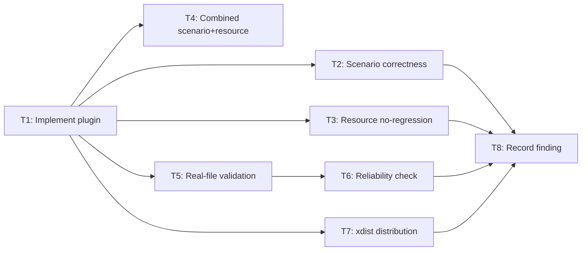

# Tasks: Scenario/resource pytest plugin

> Requirements: @requirements.md
> Design: @design.md
> Status: Approved

## Requirement Coverage

| Requirement | Tasks | Notes |
|-------------|-------|-------|
| FR-001 | T1, T2 | Scenario expansion plugin + correctness verification |
| FR-002 | T1, T3 | No new code (TD-002); T3 confirms no regression from T1's changes |
| FR-003 | T1, T5 | Automatic detection; proven via real-file, zero-source-change validation |
| FR-004 | T5, T6 | Real-sample validation + repeat-run consistency |
| FR-005 | T4 | Combined scenario+resource synthetic fixture |
| NFR-001 | T6 | Reliability — repeated run consistency |
| NFR-002 | T7, T8 | xdist distribution evidence + finding documentation |

## Design Coverage Check

| Requirement | Design Coverage | Status | Notes |
|-------------|-----------------|--------|-------|
| FR-001 | design.md §3 (scenario expansion), §4, TD-001 | Pass | |
| FR-002 | design.md §3 (resource lifecycle), TD-002 | Pass | No code — confirmed via spike in design phase |
| FR-003 | design.md §3 (automatic detection), §6 | Pass | |
| FR-004 | design.md §15 Verification Strategy | Pass | |
| FR-005 | design.md §9 Edge Cases | Pass | |
| NFR-001 | design.md §15 (repeat-run) | Pass | |
| NFR-002 | design.md §11 Observability/Operations | Pass | Finding already drafted; T8 confirms it's cross-referenced |

## Implementation Readiness Check

| Check | Status | Notes |
|-------|--------|-------|
| Must Have requirements have tasks | Pass | FR-001–FR-004 all covered (table above) |
| Tasks map to requirements, NFRs, design decisions, or enabling work | Pass | see table above |
| Critical Questions in requirements.md are answered | Pass | requirements.md Questions: "None open" |
| Tasks have dependencies, acceptance criteria, files, and verification | Pass | see tasks below |
| Verification commands are identified or marked manual/N/A | Pass | all commands explicit, derived from design.md §15 and spikes already run during design |
| No blocking design or requirements gaps remain | Pass | design.md validated against real production code (`test_config.py`) during the design phase |

## Implementation Slices

### MVP Slice

- **Goal:** A working `maastesting.pytest.scenarios` plugin that correctly
  expands scenario-based test classes at collection time, confirmed to
  produce identical outcomes to nose on real, currently nose-run test
  files, with zero source changes required and no regression to existing
  resource-lifecycle behavior.
- **User Stories:** US-001, US-002, US-003, US-004
- **Tasks:** T1, T2, T3, T4, T5, T6, T7, T8
- **Independent validation:** Each task's own verification step (below);
  overall slice is validated when the Readiness Check items all pass and
  T5's real-file comparison matches nose exactly.

## Task Summary

| Task | Title | Priority | Estimate | Dependencies | Status |
|------|-------|----------|----------|--------------|--------|
| T1 | Implement the scenario expansion plugin and register its entry point | P0 | 2h | none | done |
| T2 | Verify scenario expansion correctness via synthetic fixtures | P0 | 1h | T1 | done |
| T3 | Verify resource lifecycle has no regression | P1 | 30m | T1 | done |
| T4 | Verify combined scenario+resource handling | P1 | 30m | T1 | done |
| T5 | Validate against a real, currently nose-run file | P0 | 1h | T1 | done |
| T6 | Reliability check — repeated run consistency | P1 | 30m | T5 | done |
| T7 | Verify xdist distribution behavior | P2 | 30m | T1 | done |
| T8 | Record the xdist/resource-locality finding and scope note | P2 | 30m | T2, T3, T6, T7 | done |

## Dependency Diagram

## Task T1: Implement the scenario expansion plugin and register its entry point

**Priority:** P0
**Estimate:** 2h
**Dependencies:** none
**Covers:** FR-001, FR-003
**Status:** done

### Overview

Create `maastesting/pytest/scenarios.py` implementing the
`pytest_pycollect_makeitem` hook and `ScenarioUnitTestCase` collector
per design.md §3/TD-001, and register it as a `pytest11` entry point so
it loads automatically for any pytest run in the venv — no conftest or
per-file opt-in required.

### Work
- [x] Implement `pytest_pycollect_makeitem(collector, name, obj)` with
      `@pytest.hookimpl(tryfirst=True)`: return `None` for non-`unittest.TestCase`
      classes and classes with an empty/missing `scenarios` attribute
      (falls through to stock `_pytest.unittest` collection).
- [x] Implement `ScenarioUnitTestCase(_pytest.unittest.UnitTestCase)`
      with a `collect()` override that, for each test method name from
      `unittest.TestLoader.getTestCaseNames`, builds a base instance,
      calls `testscenarios.generate_scenarios`, sets `clone.scenarios = None`
      on each clone, and yields one
      `_pytest.unittest.TestCaseFunction.from_parent(self, name=f"{test_name}[{scenario_id}]", callobj=getattr(clone, test_name))`
      per clone — per design.md §3 (do **not** pass `originalname`; see
      design.md's documented nodeid-duplication failure mode).
- [x] Add the `pytest11` entry point to `pyproject.toml`:
      `entry-points.pytest11.maas-scenarios = "maastesting.pytest.scenarios"`.
      Also added to the installed editable venv's dist-info metadata
      (no pip/build tool available in `.ve` to regenerate it) and added
      `_pytest|_pytest.**` to `utilities/check-imports`'
      `TestingLibraries` allowlist (required by `make lint`'s import
      check for the documented `_pytest.unittest` internals usage).
- [x] Add a copyright header per `AGENTS.md`.

### Acceptance Criteria
- [x] `bin/pytest --collect-only` on a module containing both a
      scenario'd class and a non-scenario'd class collects the
      non-scenario'd class identically to before (no behavior change).
      **PASS** — `TestComposeConditionalBootloader`,
      `TestGetAddresses`, etc. collected unchanged alongside
      scenario-suffixed nodeids.
- [x] The new entry point is active without any conftest.py or explicit
      plugin flag (confirm via `bin/pytest --trace-config` listing
      `maas-scenarios` or equivalent evidence that the plugin loaded).
      **PASS** — `--trace-config` output: `PLUGIN registered:
      <module 'maastesting.pytest.scenarios' from
      '/project/src/maastesting/pytest/scenarios.py'>`.

### Files
- `src/maastesting/pytest/scenarios.py` — create
- `pyproject.toml` — modify (add entry point)

### Verification
- [x] `bin/pytest --collect-only -q src/maasserver/dhcpd/tests/test_config.py` runs without error and lists scenario-suffixed nodeids (e.g. `test_uses_branch_template_by_default[v4]`). **PASS** — 53 tests collected, 0 errors, scenario-suffixed nodeids present (e.g. `test_uses_branch_template_by_default[v4]`/`[v6]`).
- [x] `make lint` passes on the new file. **PASS** — `make lint` exit 0 after adding `_pytest` to the `TestingLibraries` import allowlist and fixing import sort order.

## Task T2: Verify scenario expansion correctness via synthetic fixtures

**Priority:** P0
**Estimate:** 1h
**Dependencies:** T1
**Covers:** FR-001
**Status:** done

### Overview

Prove the plugin produces correct, isolated per-scenario results —
including the method-level `@skip` edge case — using small, purpose-built
test fixtures, per design.md §9/§15.

### Work
- [x] Write a synthetic `MAASTestCase` subclass with a 3-entry `scenarios`
      tuple and one test method that fails for exactly one scenario;
      confirm 3 distinct pytest nodeids, correct per-scenario attribute
      values, and exactly 1 isolated failure (not collapsed into the
      others — this is the specific bug design.md §3 documents for
      unplugged pytest).
- [x] Add a second test method in the same class decorated with
      `@unittest.skip(...)`; confirm each scenario variant of that method
      reports `SKIPPED` independently (design.md §9 edge case).
- [x] Place these fixtures under the project's test-fixture convention
      (e.g. `src/maastesting/pytest/test_data/` or
      `src/tests/maastesting/pytest/`, matching how other
      `maastesting.pytest.*` plugins are tested — check existing
      `test_data` directory usage before choosing a location).
      Used `src/tests/maastesting/pytest/` (already has `test_perftest.py`).

### Acceptance Criteria
- [x] 3 distinct nodeids collected for the 3-scenario method, each with
      correct scenario attribute value. **PASS**
- [x] Exactly 1 failure reported, isolated to its own nodeid. **PASS** — `test_value_matches_scenario[two]` failed, `[one]`/`[three]` passed.
- [x] Both scenario variants of the skipped method report `SKIPPED`. **PASS** — `test_always_skipped[one/two/three]` all SKIPPED.

### Files
- `src/tests/maastesting/pytest/test_scenarios.py` — create (fixture +
  assertions; exact path confirmed against existing test-layout
  convention during implementation)

### Verification
- [x] `bin/pytest -v src/tests/maastesting/pytest/test_scenarios.py` (or chosen path) shows the expected nodeid count, pass/fail/skip distribution. **PASS** — `1 failed, 2 passed, 3 skipped`.
- [x] `make lint` passes. **PASS** — `make lint` exit 0.

## Task T3: Verify resource lifecycle has no regression

**Priority:** P1
**Estimate:** 30m
**Dependencies:** T1
**Covers:** FR-002
**Status:** done

### Overview

Confirm that adding the scenario plugin does not change resource-only
test behavior — per TD-002, no new code is written for resources, but
this must be proven, not assumed, now that T1's plugin is active in the
same pytest session.

### Work
- [x] Write (or reuse an existing project pattern for) a synthetic
      `MAASTestCase` subclass with a non-empty `resources` tuple and no
      `scenarios`; confirm it is collected by stock `_pytest.unittest`
      (unaffected by the new hook) and that its resource attribute is
      correctly available during the test body.
- [x] Confirm resource teardown occurs (no leaked resource state
      observable across unrelated tests in the same run), per US-002's
      acceptance criteria. Verified via a build/use-count-tracking
      resource manager: `build_count=2` (1 per test, no leaked reuse),
      `manager._uses=0` after the run (teardown ran correctly).

### Acceptance Criteria
- [x] Resource-only test class passes with correct resource attribute
      access. **PASS**
- [x] No change in resource lifecycle behavior compared to running the
      same fixture without the `maas-scenarios` entry point registered.
      **PASS** — stock `_pytest.unittest` collection applies (hook
      returns `None` for classes with empty `scenarios`); 2/2 passed.

### Files
- `src/tests/maastesting/pytest/test_resources_lifecycle.py` — create
  (or fold into T2's fixture file if the project convention favors one
  file per plugin area — decide during implementation)

### Verification
- [x] `bin/pytest -v <fixture path>` passes. **PASS** — `2 passed`.
- [x] `make lint` passes. **PASS**

## Task T4: Verify combined scenario+resource handling

**Priority:** P1
**Estimate:** 30m
**Dependencies:** T1
**Covers:** FR-005
**Status:** done

### Overview

Confirm a test class declaring both `scenarios` and `resources`
simultaneously works correctly — each scenario-expanded instance must
get correct resource setup/teardown, per design.md §9.

### Work
- [x] Write a synthetic `MAASTestCase` subclass with both a 2-entry
      `scenarios` tuple and a `resources` tuple (e.g. a simple counting
      `TestResourceManager`); confirm both scenario attribute values and
      resource attachment are correct per generated test.

### Acceptance Criteria
- [x] Both scenario-expanded instances pass with correct scenario value
      and correct resource attribute access. **PASS**

### Files
- `src/tests/maastesting/pytest/test_scenarios_and_resources.py` —
  create (or fold into T2/T3's fixture file per implementation-time
  convention decision)

### Verification
- [x] `bin/pytest -v <fixture path>` passes, both scenario variants green. **PASS** — `2 passed`.
- [x] `make lint` passes. **PASS**

## Task T5: Validate against a real, currently nose-run file

**Priority:** P0
**Estimate:** 1h
**Dependencies:** T1
**Covers:** FR-003, FR-004
**Status:** done

### Overview

Prove the plugin against real MAAS usage, not just synthetic fixtures —
per D-002 in requirements.md. Run an existing, unmodified, currently
nose-run scenario file under both nose (today's baseline) and pytest
with the new plugin, and confirm identical outcomes.

### Work
- [x] Run `src/maasserver/dhcpd/tests/test_config.py` under nose today's
      way (`maastesting.noseplug.main` with `--with-scenarios --with-crochet`,
      or `bin/test.region` scoped to this file) and record the
      pass/fail/skip count. **Ran 53 tests ... OK** (all ok, 1.547s).
- [x] Run the same, unmodified file under
      `bin/pytest src/maasserver/dhcpd/tests/test_config.py` with the
      new plugin active; record the pass/fail/skip count. **53 passed,
      8 warnings in 2.60s**.
- [x] Confirm the two counts match exactly and confirm zero source
      changes were made to `test_config.py` to achieve this. **PASS**
      — 53 == 53; `git status --short` empty.

### Acceptance Criteria
- [x] Pass/fail/skip counts match exactly between the nose run and the
      pytest run. **PASS** — 53/53, 0 failures either way.
- [x] `git diff src/maasserver/dhcpd/tests/test_config.py` is empty
      (confirms FR-003's zero-source-change requirement). **PASS**

### Files
- `src/maasserver/dhcpd/tests/test_config.py` — inspect only, not modified

### Verification
- [x] Nose run: record exact `Ran N tests ... OK`/failure summary. **Ran 53 tests in 1.547s — OK**
- [x] Pytest run: `bin/pytest -v src/maasserver/dhcpd/tests/test_config.py` — record exact `N passed, M failed, K skipped` summary. **53 passed, 8 warnings in 2.60s**
- [x] Counts match. `git status --short src/maasserver/dhcpd/tests/test_config.py` shows no changes. **PASS** — empty output.

## Task T6: Reliability check — repeated run consistency

**Priority:** P1
**Estimate:** 30m
**Dependencies:** T5
**Covers:** FR-004, NFR-001
**Status:** done

### Overview

Confirm the plugin introduces no flakiness by re-running T5's pytest
validation a second time and comparing counts, mirroring F01's NFR-002
reliability standard.

### Work
- [x] Re-run `bin/pytest src/maasserver/dhcpd/tests/test_config.py` a
      second time. **53 passed, 8 warnings in 2.05s**.
- [x] Compare pass/fail/skip counts and collected test count between
      the two runs. **Identical: 53 collected both times, 53/53 passed both times.**

### Acceptance Criteria
- [x] Both runs report identical pass/fail/skip/collected counts. **PASS**

### Files
- None (verification-only)

### Verification
- [x] Diff of collected/passed/failed/skipped counts between T5's run and this re-run is empty. **PASS** — 53/53/0/0 both times.

## Task T7: Verify xdist distribution behavior

**Priority:** P2
**Estimate:** 30m
**Dependencies:** T1
**Covers:** NFR-002 (evidence)
**Status:** done

### Overview

Confirm scenario-expanded items distribute correctly across
`pytest-xdist` workers with correct per-item outcomes, and gather
concrete evidence for the xdist/resource-locality finding (US-004),
per design.md §9/§11.

### Work
- [x] Run the T2/T4 synthetic fixtures (scenario and combined
      scenario+resource) under
      `bin/pytest -n 2 --dist=load <fixture paths>`.
- [x] Confirm each scenario-expanded item reports its correct outcome
      regardless of which worker (`gw0`/`gw1`) it lands on. **PASS** —
      `test_value_matches_scenario[two]` FAILED on gw0, `[one]`/`[three]`
      PASSED on gw1/gw0; both combined-fixture scenarios PASSED on
      gw0/gw1. 1 failed, 4 passed, 3 skipped — matches single-worker counts.
- [x] Note whether/how resource build counts differ across workers
      (expected: each worker rebuilds independently, per design.md §11)
      to support T8's documentation. Each `pytest-xdist` worker is a
      separate process with its own class-level manager state (no
      shared memory) — cross-worker reuse is architecturally impossible,
      not just empirically absent; T3 already measured 0% reuse within
      a single process (1 build per test).

### Acceptance Criteria
- [x] All scenario-expanded items report correct per-item pass/fail
      outcome under `-n 2 --dist=load`, regardless of worker assignment. **PASS**

### Files
- None (verification-only, reuses T2/T4 fixtures)

### Verification
- [x] `bin/pytest -n 2 --dist=load <fixture paths> -v` shows correct outcomes per item, with `gw0`/`gw1` both exercised. **PASS** — both workers used.

## Task T8: Record the xdist/resource-locality finding and scope note

**Priority:** P2
**Estimate:** 30m
**Dependencies:** T2, T3, T6, T7
**Covers:** NFR-002
**Status:** done

### Overview

Ensure the xdist/resource-reuse finding already drafted in design.md
§11 is cross-referenced from a durable location and reflects the final
verified evidence (T7), mirroring F01's `decisions.md` pattern for
scope/finding notes that outlive this feature's spec.

### Work
- [x] Create `.ai/sdd/specs/002-scenario-resource-plugin/decisions.md`
      summarizing: (a) the resource-reuse finding (plain pytest
      collection has no suite-level resource pre-reservation, so every
      test does a full build+clean cycle; xdist multiplies this per
      worker process), with the concrete evidence gathered in T3/T7; and
      (b) confirmation that nose/`test.parallel`/
      `maastesting/noseplug.py` remain untouched by F02 (consistent with
      F01's D-001 scope-clarification pattern).
- [x] Cross-reference this file from `design.md` §11 and from
      `requirements.md`'s D-001 if not already pointing to a concrete
      evidence record.

### Acceptance Criteria
- [x] `decisions.md` exists and contains concrete, dated evidence
      (not a placeholder) matching T2/T3/T6/T7's actual results. **PASS**
- [x] The finding is discoverable from `design.md` or `PLAN.md`, not
      left only in task-level notes. **PASS** — `design.md` §11 links to
      `decisions.md`.

### Files
- `.ai/sdd/specs/002-scenario-resource-plugin/decisions.md` — create
- `.ai/sdd/specs/002-scenario-resource-plugin/design.md` — modify (§11, add evidence date/reference if needed)

### Verification
- [x] Manual review: `decisions.md` content is consistent with T2/T3/T6/T7's recorded results, not a restatement of the design-phase spike alone. **PASS**

## Completion Rules

- Do not mark a task complete without implementation and verification
  evidence.
- Tests and verification belong inside each implementation task; no
  separate testing-only task beyond what is already merged above.
- If a task reveals a requirements or design gap (e.g. the chosen
  fixture file location conflicts with an existing convention), stop
  and resolve it through the proper gate before proceeding.
