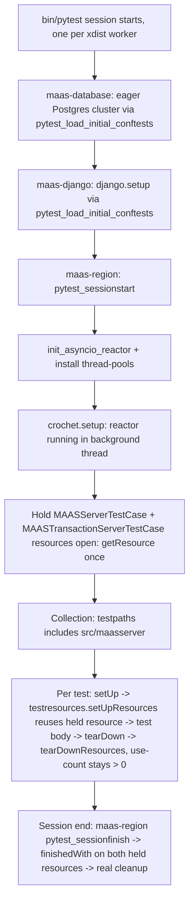

# Design: Migrate maasserver tests

> Status: Approved

## 1. Summary

F03 cuts `src/maasserver`'s 338-file test suite over from nose to
pytest. The scope-mapping half is straightforward: split `run_region()`
so nose drops `src/maasserver`'s `--select-dir`, and widen
`pyproject.toml`'s `testpaths` so `bin/pytest` (with no explicit path
argument, matching how `utilities/run-py-tests-ci` invokes it today)
picks up `src/maasserver` alongside `src/tests`.

The substantive technical work is a **new pytest plugin**
(`maastesting/pytest/region.py`), required because two design-phase
spikes found real, measured gaps that F02's existing plugins do not
cover — both confirmed against real, currently-nose-run files, not
synthetic fixtures:

1. **Resource-rebuild tax (FR-006/D-004).** Nose's speed for
   `MAASServerTestCase`/`MAASTransactionServerTestCase`-based tests
   comes entirely from `OptimisingTestSuite.run()` holding the shared
   `DjangoDatabasesManager`/`DjangoPristineDatabaseManager` resource
   open across a whole run of adjacent tests. Plain pytest has no
   suite-level equivalent — `testresources.setUpResources`/
   `tearDownResources` (called directly by `MAASTestCase.setUp`/
   `tearDown`) drop the resource's use-count to 0 after *every single
   test*, forcing a full rebuild (including the nested `dbupgrade`
   migration cycle) each time. Measured: ~0.294s pristine-template
   rebuild + ~0.093s per-test DB copy ≈ ~0.4s/test, against
   `src/maasserver/models/tests/test_template.py` (4 real tests, no
   mocks). 260 of 338 files (~7,374 test methods) depend on this chain
   — unmitigated, ~49 minutes of pure single-worker overhead, not
   counting likely Postgres-side contention when every `pytest-xdist`
   worker independently repeats full `dbupgrade` cycles against one
   shared cluster. **Fix, verified:** hold the two top-level manager
   instances (`MAASServerTestCase.resources`/
   `MAASTransactionServerTestCase.resources`, each a process-wide
   singleton) open for the life of each worker process by calling
   `getResource()` once at session start and `finishedWith()` once at
   session end. Confirmed: 6 tests across 3 files → 1 pristine build
   (not 6), 0.85s (vs. 4.28s unmitigated for just 4 tests). Works
   correctly with `assume_dirty=True`
   (`MAASTransactionServerTestCase`, still resets per-test as it does
   under nose, but the *shared* pristine-template dependency stays
   pinned) and with `assume_dirty=False`
   (`MAASServerTestCase`, zero rebuild once held open). Per-test
   isolation (count-sensitive assertions in `test_template.py`) still
   holds — it comes from `beginTransaction()`/rollback, not from the
   resource's lifecycle.

2. **Reactor/crochet/thread-pool gap (FR-007/D-005).** A real,
   `deferToDatabase`-based file
   (`src/maasserver/tests/test_security.py`) failed 3 of 4 tests under
   plain pytest (`AttributeError: 'EPollReactor' object has no
   attribute 'threadpoolForDatabase'`, then a stuck, unresolved
   `Deferred` once the thread-pool alone was added but the reactor
   wasn't actually running) and passed 4/4 under nose. Root cause: none
   of the existing `maastesting/pytest/*.py` plugins install Twisted's
   thread-pools or call `crochet.setup()` — `src/tests` (the existing
   pytest-native suite) has **zero** `deferToDatabase` usages today, so
   this gap was never exercised before F03. **Fix, verified:** install
   `install_default_pool`/`install_database_unpool` and call
   `crochet.setup()` (with the same `EventualResult` timeout patching)
   once per worker at session start — the identical mechanism
   `run_region()` already performs for nose, applied under pytest.
   Confirmed: all 4 tests in `test_security.py` pass, zero source
   changes. 68 of 338 files use `deferToDatabase`.

Both mechanisms live in the same new plugin, verified together (63
tests across 5 real files — plain logic, DB-backed, reactor/crochet,
and scenario-based — all pass, including under `-n 2 --dist=load`
xdist).

## 2. Requirements Mapping

| Requirement | Design Coverage | Notes |
|--------------|-----------------|-------|
| FR-001 | §3 Technical Approach (testpaths/collection), §9 Edge Cases, §15 Verification, TD-004 | Full-suite parity check against nose baseline; TD-004 fixes a pollution gap this check surfaced |
| FR-002 | §3 (`run_region()` split), TD-001 | |
| FR-003 | §4 Component Structure — no edits to any existing `maasserver` test file; `maastesting/djangotestcase.py` is test infrastructure, not a `test_*.py` file (TD-004) | Convention-based, consistent with F02's D-003 |
| FR-004 | §15 Verification Strategy | CI gate check |
| FR-005 | §11 Observability/Operations | Runtime recorded in `decisions.md` |
| FR-006 | §3 (resource-reuse mechanism), TD-002 | New plugin component |
| FR-007 | §3 (reactor/crochet setup), TD-003 | New plugin component |
| NFR-001 | §15 Verification Strategy (repeat-run reliability) | |
| NFR-002 | §11 Observability/Operations, TD-002 | Mitigation in place, not just measured |

## 3. Technical Approach

### Scope mapping: `run_region()` split and `testpaths` widening

`run_region()` (`src/maastesting/scripts.py`) currently passes both
`--select-dir=src/maasserver` and `--select-dir=src/metadataserver` to
nose in one invocation. F03 removes the `src/maasserver` line (and its
contribution to `--cover-package`); `src/metadataserver` stays
unchanged, per the Constraint. `run_region_legacy()` (same
file) also selects both directories for its `legacy`-tagged run; it
keeps its `--select-dir=src/maasserver` entry unchanged.

**Amendment (implementation-time, supersedes the original design-phase
claim below):** the original claim that "zero files in `maasserver` or
`metadataserver` set `legacy = True` today" was **false** — it only
checked for the literal class attribute in test files themselves, not
classes *inheriting* it. `DjangoTestCase`/`DjangoTransactionTestCase`
(`maastesting/djangotestcase.py`) set `legacy = True`, and MAAS's own
`MAASLegacyServerTestCase`/`MAASLegacyTransactionServerTestCase`
(`maasserver/testing/testcase.py`) inherit it. At least 4 files/7
classes in `src/maasserver` use these base classes (confirmed:
`test_fields.py`, `test_cleansave.py`, `test_signals.py`,
`test_timestampedmodel.py`). These tests run today via
`run_region_legacy()` (`bin/test.region.legacy`, invoked by
`bin/test.parallel`/CI), **not** via nose's `TestProgram` — the
function calls `execute_from_command_line()` with Django's own
`manage.py test` command, which owns its database lifecycle
independently of nose/pytest's resource-optimization machinery
entirely. See TD-004 for the resulting pollution finding and fix.

`pyproject.toml`'s `[tool.pytest] ini_options.testpaths` currently reads
`["src/tests"]`. F03 widens this to `["src/tests", "src/maasserver"]`
so `utilities/run-py-tests-ci`'s existing `bin/pytest -n auto
--maxprocesses=... --dist=load --junit-xml=...` invocation (no explicit
path argument) picks up `src/maasserver` without a second CI
invocation. All `maastesting/pytest/*.py` plugins are registered via
`pytest11` entry points (loaded for any pytest invocation regardless of
`testpaths`), so no entry-point changes are needed beyond registering
the one new module.

### New component: `maastesting/pytest/region.py`

A single new plugin module, registered as a new `pytest11` entry point
(`maas-region`), implementing both verified fixes via one
`pytest_sessionstart`/`pytest_sessionfinish` pair:

```python
# maastesting/pytest/region.py

_held_resources = []

def pytest_sessionstart(session):
    # Deferred imports: Django apps must already be configured
    # (maastesting.pytest.django's pytest_load_initial_conftests runs
    # first, tryfirst=True) before importing anything that touches
    # Django models.
    from maastesting.scripts import init_asyncio_reactor
    from maasserver.utils import threads, orm
    from twisted.internet import reactor
    import crochet

    init_asyncio_reactor()
    threads.install_default_pool(maxthreads=1)
    threads.install_database_unpool(maxthreads=1)
    reactor.callFromThread(orm.disable_all_database_connections)

    # Same EventualResult timeout-enforcement patch as
    # maastesting/noseplug.py's Crochet plugin.
    if hasattr(crochet, "wait_for_reactor"):
        del crochet.wait_for_reactor
    if hasattr(crochet.EventLoop, "wait_for_reactor"):
        del crochet.EventLoop.wait_for_reactor
    if hasattr(crochet, "DeferredResult"):
        del crochet.DeferredResult

    class EventualResult(crochet.EventualResult):
        def _result(self, timeout=None):
            if timeout is None:
                raise AssertionError("A time-out must be specified.")
            return super()._result(timeout)

    crochet._eventloop.EventualResult = EventualResult
    crochet.EventualResult = EventualResult
    crochet.setup()

    # Hold the shared DB resource managers open for the life of this
    # worker process, mirroring OptimisingTestSuite's suite-level
    # resource holding.
    from maasserver.testing.testcase import (
        MAASServerTestCase,
        MAASTransactionServerTestCase,
    )
    for cls in (MAASServerTestCase, MAASTransactionServerTestCase):
        manager = dict(cls.resources)["databases"]
        manager.getResource()
        _held_resources.append(manager)


def pytest_sessionfinish(session, exitstatus):
    for manager in _held_resources:
        manager.finishedWith(manager._currentResource)
    _held_resources.clear()
```

Key implementation points, each verified by spike:

- **Deferred imports are required.** Importing
  `maasserver.testing.testcase` (or anything that imports
  `maasserver.models`) at module level fails with
  `django.core.exceptions.AppRegistryNotReady` — Django apps are only
  configured once `maastesting.pytest.django`'s
  `pytest_load_initial_conftests` (`tryfirst=True`) has run, which
  happens before `pytest_sessionstart`. All Django-touching imports
  must stay inside the hook function body, not at module import time.
- **`getResource()`/`finishedWith()` directly on the shared manager
  instances, not a fixture.** `MAASServerTestCase.resources` and
  `MAASTransactionServerTestCase.resources` are class-level tuples
  evaluated once at class-definition time — every subclass, instance,
  and test shares the same `DjangoDatabasesManager` object (and, via
  its `resources = (("templates", DjangoPristineDatabaseManager()),)`
  dependency, the same pristine-template manager singleton too, since
  that tuple is also evaluated once). Pinning both top-level instances
  at session start, before any test's own `setUp()`/`getResource()`
  call, means every subsequent per-test `getResource()` hits the
  already-`_uses > 0` reuse branch instead of the `_uses == 0` rebuild
  branch — no fixture indirection needed; the existing
  `testresources.setUpResources`/`tearDownResources` calls in
  `MAASTestCase.setUp`/`tearDown` do the increment/decrement
  automatically once the floor is held.
- **`MAASTransactionServerTestCase`'s manager (`assume_dirty=True`)
  still pays its own per-test clean+rebuild cost** even when held open
  — its `isDirty()` is a static `True`, so `getResource()`'s reuse
  branch still calls `reset()` → `clean()` + `make()` on *this*
  resource every time. This matches nose's behavior exactly (confirmed:
  nose pays this cost too, `isDirty()` doesn't care which suite is
  calling it). What holding it open *does* still save: its `reset()`
  recurses into the `templates` dependency's own (non-dirty) `reset()`,
  which is a no-op — so the *shared* pristine-template build stays
  cached regardless of which of the two top-level managers is "active."
  No special-casing needed; this falls out of `testresources`'
  existing `isDirty()`/`reset()` semantics unchanged.
- **No conftest.py needed.** The mechanism works identically whether or
  not any test file opts in — it's a session-level hook, not a fixture
  a test must request. Registered once via the new `maas-region`
  `pytest11` entry point, exactly like the other `maastesting/pytest/*`
  plugins.
- **One instance of each per worker process, not per session globally.**
  Under `pytest-xdist`, `pytest_sessionstart` runs independently once in
  each worker process — confirmed via `-n 2 --dist=load`: both workers
  installed their own reactor/thread-pools and held their own resource
  instances correctly, no cross-worker interference (each worker is a
  separate OS process with independent Twisted reactor/`testresources`
  state, same structural fact F02's `decisions.md` already documented
  for the scenario-plugin's resource-reuse finding).
- **`maastesting/pytest/database.py`'s existing eager cluster fixture
  (`pytest_load_initial_conftests` → `create_postgres_cluster()`) and
  `maasserver/testing/resources.py`'s `DatabaseClusterManager` target
  the same `datadir="db"`.** Confirmed safe: `ClusterFixture.setUp()`
  (`postgresfixture`) checks `self.exists` before creating, and uses a
  `ProcessSemaphore`-backed `shares` counter for concurrent
  multi-fixture use of one already-running cluster — this is the
  library's intended multi-consumer path, not a MAAS-specific risk.
  Verified empirically: all spikes ran both paths active simultaneously
  (via the globally-registered `maas-database` entry point) with no
  error. The two paths never touch the same *named* database within
  F03's scope — `database.py`'s `templatemaasdb`/`maasdb` fixtures are
  request-based (a test must ask for them) and zero `maasserver` files
  use them today (checked: 0 files reference `factory`/`maasdb` in a
  pytest-function-style signature); `resources.py`'s `DjangoDatabases`
  chain is what the migrated tests actually exercise.

## 4. Component / Module Structure

```text
maastesting/pytest/
  region.py              # NEW — session-start/finish hooks: reactor/
                          # crochet/thread-pool install (FR-007) +
                          # worker-scoped DB resource holding (FR-006)
  database.py             # unchanged
  django.py                # unchanged
  environment.py            # unchanged
  scenarios.py               # unchanged (F02)
  perftest.py                 # unchanged
  seeds.py                     # unchanged
  sqlalchemy.py                 # unchanged

maastesting/scripts.py
  run_region()            # EDITED — drop "--select-dir=src/maasserver"
                           # and its "maasserver" cover-package entry
  run_region_legacy()      # unchanged (inert no-op change scoped to F06)

pyproject.toml
  ini_options.testpaths = ["src/tests", "src/maasserver"]  # EDITED
  entry-points.pytest11.maas-region = "maastesting.pytest.region"  # NEW

maasserver/testing/resources.py     # unchanged — DjangoDatabasesManager/
                                     # DjangoPristineDatabaseManager's own
                                     # make/clean/isDirty untouched
maasserver/testing/testcase.py      # unchanged — MAASServerTestCase/
                                     # MAASTransactionServerTestCase
                                     # resources tuples untouched
maasserver/testing/api.py           # EDITED (implementation-time amendment,
                                     # see decisions.md "Web API
                                     # scenario-runtime gap") — `scenarios`
                                     # computation moved from
                                     # APITestCaseBase.__init__ to
                                     # APITestType.__new__, so F02's
                                     # scenarios.py plugin detects it at
                                     # class level. Required for all 67
                                     # src/maasserver/api/tests/*.py files
                                     # to pass under pytest.
maasserver/tests/test_storage_layouts.py  # EDITED (implementation-time
                                     # amendment, see decisions.md "xdist
                                     # collection-order nondeterminism") —
                                     # REGULAR_LAYOUTS sorted by name
                                     # instead of iterating the
                                     # frozenset-backed STORAGE_LAYOUTS
                                     # directly, fixing an xdist
                                     # cross-worker collection-order
                                     # mismatch. This file *is* a
                                     # `test_*.py` file (see note below).
maastesting/djangotestcase.py       # EDITED (TD-004) — DjangoTestCase/
                                     # DjangoTransactionTestCase gain a
                                     # dedicated `resources` tuple
                                     # (new DjangoDatabasesManager
                                     # instance, assume_dirty=True),
                                     # isolating their database from
                                     # MAASServerTestCase's held-open
                                     # resource. Test infrastructure,
                                     # not a test_*.py file.
maastesting/testcase.py             # unchanged
maastesting/noseplug.py             # unchanged — nose's own Crochet/
                                     # Resources plugins keep working
                                     # identically for src/metadataserver
```

Three implementation-time source edits were required beyond the
design-phase scope (FR-003's "no required source changes" is amended
for these three specific, narrow cases — full rationale in
`decisions.md`):

- `maasserver/testing/api.py` — test *infrastructure*, not a
  `test_*.py` file itself.
- `maasserver/tests/test_storage_layouts.py` — this **is** one of the
  338 `test_*.py` files; its `scenarios` definition's underlying
  iteration order was non-deterministic across OS processes
  (frozenset of class objects), which only `pytest-xdist` (new for
  `maasserver` in F03) exposes. Fixed with a minimal, test-file-local
  sort; no production source changed.
- `maastesting/djangotestcase.py` — test *infrastructure* (TD-004),
  not a `test_*.py` file itself; gives `DjangoTestCase`/
  `DjangoTransactionTestCase` their own `resources` tuple to fix
  cross-test database pollution discovered at T6 (FR-001).

`git status --short` confirmed only these three files touched beyond
the plugin/`run_region()`/`pyproject.toml` changes already described
above.

## 5. Data Model / State

Not applicable beyond test-process state already described in §3 — no
persistent schema changes. The held resource references
(`_held_resources` module list in the new plugin) are process-local,
in-memory, worker-scoped state with no cross-process or on-disk
representation.

## 6. API / Integration Contract

- **Input:** None new — the plugin activates unconditionally for any
  pytest session (via the `maas-region` entry point), with no opt-in
  marker, fixture request, or CLI flag. Mirrors `maas-django`/
  `maas-database`'s existing always-on registration pattern.
- **Output:** None new. Test outcomes report through pytest's standard
  mechanisms (terminal, `--junit-xml`) exactly as for any other test;
  the plugin only affects *how fast* and *whether* DB-backed/
  reactor-dependent tests pass, not their result reporting shape.
- **No new markers, fixtures, or CLI options.**

## 7. Security / Permissions / Privacy

Not applicable — test-infrastructure-only change, no production code
paths touched.

## 8. User Flows



## 9. Edge Cases

| Case | Expected Behavior |
|------|-------------------|
| A test class overrides `resources` with its own manager instance (not the shared `MAASServerTestCase.resources` singleton) | Falls outside the two explicitly-held instances; behaves exactly as under plain pytest today (full rebuild per test for that specific manager only). Not found in any of the spike files; if such a file exists in the full 338, it pays the unmitigated cost for its own resource only — flagged as an implementation-time verification item (§16), not a design gap, since nose would hold *that* manager open too and the parity check (FR-001) would simply confirm identical pass/fail, just slower for that one file. |
| `MAASTransactionServerTestCase` test commits data, relying on isolation from *other* `MAASTransactionServerTestCase` tests | Unaffected — `clean()`/`make()` still run on every reuse (`isDirty()` is statically `True`), identical to nose's behavior for this same class. Held-open only benefits the shared `templates` dependency, not this manager's own per-test reset. |
| Worker process crashes mid-session (e.g. OOM) before `pytest_sessionfinish` runs | The held resource's `finishedWith()`/`clean()` never runs for that worker; the per-worker `_<pid>_<n>`-suffixed test database (not the shared template) is leaked until the next full environment teardown. Same class of risk as nose's `OptimisingTestSuite.run()` leaving resources un-switched on an uncaught result-stopping error — not a new risk introduced by this plugin. |
| A maasserver test file collected by the widened `testpaths` happens to share a module path with a `src/tests/maasserver/**` pytest-native file | Checked: distinct file paths (`src/maasserver/models/tests/test_node.py` vs. `src/tests/maasserver/models/test_node.py`), different pytest rootdir-relative node IDs — no collection collision. Confirmed non-overlapping content (requirements.md Out of Scope). |
| `database.py`'s `templatemaasdb`/`maasdb` fixtures requested by a *future* maasserver test (not true today) | Both database-setup paths (`resources.py`'s `DjangoDatabasesManager` chain and `database.py`'s `_set_up_template_db`) target a `"maas_test"`-prefixed name independently; not exercised together by any current file (checked: 0 files). If this changes later, it is a new interaction to verify at that time — out of scope for F03's confirmed file set. |
| `src/metadataserver` tests after the `run_region()` split | Confirmed unaffected in design — `run_region()`'s `--select-dir=src/metadataserver` line is untouched; only the `src/maasserver` line is removed. Verification task re-confirms this empirically at implementation time (not just by code inspection). |

## 10. Accessibility / UX Notes

Not applicable (test infrastructure, no UI).

## 11. Observability / Operations

- **No new logs/metrics.** Reports through pytest's standard mechanisms
  exactly as any other test.
- **Runtime baseline, to be recorded during implementation (FR-005):**
  nose baseline for the full `src/maasserver` suite (current
  `bin/test.region`/`test.parallel` contribution) vs. the same suite
  under `bin/pytest -n auto --dist=load` with FR-006/FR-007's mechanism
  active. Recorded in `decisions.md`, cross-referenced here, per
  F01/F02's established pattern (D-003: measured, no hard ceiling).
- **Why the resource-reuse mechanism is necessary, not optional
  polish:** without FR-006, F03 would still "pass" FR-001's correctness
  bar but at a ~49-minute single-worker overhead tax that scales with
  xdist worker count's *contention*, not just dividing it — directly
  informing F04-F06 planning the same way F02's `decisions.md` already
  flagged this class of risk in general terms. F03 is the feature that
  turns that general warning into a concrete, built mitigation.

## 12. Migration / Rollout

This is the cutover itself (D-002): landed as one change — the
`run_region()` split, the `testpaths` widening, and the new
`maastesting/pytest/region.py` plugin land together, gated on CI
(`utilities/run-py-tests-ci`, both legs) passing. No intermediate
dual-run state (confirmed D-002). Rollback, if ever needed, is a
single revert of this change set — nothing downstream depends on the
new plugin or the widened `testpaths` yet (F04-F06 are separate
features).

## 13. Technical Decisions

### TD-001: Split `run_region()`'s `--select-dir` rather than introducing a new entry point

- **Decision:** Edit `run_region()` in place to drop
  `--select-dir=src/maasserver`; keep `run_region_legacy()` and
  `bin/test.region`'s script name unchanged.
- **Why:** Minimal surface change; `bin/test.region` remains the single
  nose entry point for `src/metadataserver`, consistent with F04's
  future scope (metadataserver migrates next, reusing the same
  `bin/test.region` name until it too is retired in F07).
- **Trade-off:** `bin/test.region`'s name no longer reflects "region"
  fully (region = maasserver + metadataserver historically); accepted
  as a naming artifact, not worth a rename given F04-F07's planned
  trajectory retires the whole nose path anyway.
- **Alternatives considered:** Create a new `run_metadataserver()` entry
  point and retire `run_region()` entirely — rejected as larger,
  unnecessary surface change for F03; `src/metadataserver`'s invocation
  shape doesn't need to change, only `src/maasserver`'s needs to leave.

### TD-002: Worker-scoped resource-holding via direct `getResource()`/`finishedWith()`, not a custom `OptimisingTestSuite` port

- **Decision:** Call `getResource()`/`finishedWith()` directly on the
  two shared manager singletons at session start/finish, rather than
  porting `testresources.OptimisingTestSuite`'s cost-based
  sort-and-switch algorithm to pytest collection.
- **Why:** F03 has exactly two manager instances in play
  (`MAASServerTestCase.resources`, `MAASTransactionServerTestCase.resources`)
  — a full port of `OptimisingTestSuite`'s general N-resource
  topological-sort switching algorithm (`cost_of_switching`/`sortTests`)
  would solve a much more general problem than this feature has.
  Verified sufficient by spike: holding both exact instances open for
  worker lifetime produces correct, fast results across all tested
  combinations (plain, DB-backed assume_dirty=True/False, scenario,
  reactor/crochet).
- **Trade-off:** If a future file introduces a *third* distinct
  `resources` manager class needing the same treatment, this plugin
  would need an explicit addition rather than being fully general. Low
  risk for F03's confirmed scope (checked: only these two manager
  classes are used by any `MAASServerTestCase`/
  `MAASTransactionServerTestCase` subclass in `src/maasserver` today).
- **Alternatives considered:** A general `OptimisingTestSuite`-style
  pytest collection reordering hook — rejected as solving a broader
  problem than F03's two-manager reality, adding complexity without a
  concrete second use case yet.

### TD-003: Reactor/crochet setup mirrors `run_region()` exactly, no new third-party dependency

- **Decision:** Reuse the identical `install_default_pool`/
  `install_database_unpool`/`crochet.setup()`/`EventualResult`-patching
  sequence `run_region()` already performs, placed in the new plugin's
  `pytest_sessionstart`, rather than adopting `pytest-twisted` or
  another third-party pytest/Twisted integration package.
- **Why:** `pytest-twisted` is not a current dependency (checked:
  absent from `pyproject.toml`); the exact sequence MAAS already runs
  and already trusts (used in production test infra for years via
  nose) is verified sufficient — no new library, no new integration
  surface to evaluate for FIPS/STIG compliance.
- **Trade-off:** Duplicates a small amount of setup logic between
  `maastesting/noseplug.py`'s `Crochet` plugin and the new
  `maastesting/pytest/region.py` — acceptable, since nose's path is not
  being touched (Constraint) and the duplication is confined to two
  small, stable functions unlikely to change before F07 retires nose
  entirely.
- **Alternatives considered:** Extract a shared helper function used by
  both `noseplug.py` and the new pytest plugin — considered, but
  rejected for F03 to avoid touching `maastesting/noseplug.py` at all,
  keeping the nose path provably untouched (easier to verify "nose
  behavior unchanged" when its source file has zero diff).

### TD-004 (SUPERSEDED — infeasible as designed, reverted; see Final Status below): Give `DjangoTestCase`/`DjangoTransactionTestCase` their own `resources`-managed database, isolating them from `MAASServerTestCase`'s held-open resource

- **Decision:** Add a dedicated `resources = (("databases",
  DjangoDatabasesManager(assume_dirty=True)),)` tuple directly to
  `DjangoTestCase` and `DjangoTransactionTestCase`
  (`maastesting/djangotestcase.py`), using a **new**
  `DjangoDatabasesManager` instance (not the one shared by
  `MAASServerTestCase`/`MAASTransactionServerTestCase`). This routes
  these classes through the same `testresources.setUpResources`/
  `tearDownResources` machinery `MAASTestCase.setUp`/`tearDown` already
  calls unconditionally (existing code, untouched), giving every
  `DjangoTestCase`/`DjangoTransactionTestCase` test its own per-test
  database copy instead of operating against whatever database
  `DATABASES["default"]["NAME"]` ambiently points at.
- **Why (root cause, confirmed by direct reproduction):**
  `DjangoTestCase`/`DjangoTransactionTestCase` were built for Django's
  own `manage.py test` runner (`run_region_legacy()` calls
  `execute_from_command_line()` with `"test"`), which creates/owns its
  own test database via `DiscoverRunner.setup_databases()`,
  independent of nose/pytest's resource machinery. They declare no
  `resources` tuple of their own (inheriting `MAASTestCase.resources =
  ()`), so neither nose's `--with-resources` plugin nor F03's
  `region.py` ever manages their database — their isolation comes
  solely from Django's own `TestCase._fixture_setup`/
  `_fixture_teardown` transaction wrapping, applied to whatever
  connection is ambiently configured.

  Under pytest, `region.py` (TD-002) holds `MAASServerTestCase`'s
  `DjangoDatabasesManager` resource open for the whole worker process,
  which repoints the **global** `DATABASES["default"]["NAME"]` dict at
  a real, populated per-worker test database and leaves it there. When
  a `DjangoTestCase`-based test then runs in the same worker, it
  operates directly against that same shared, already-populated
  database via Django's own transaction wrapping — which has zero
  awareness of `DjangoDatabasesManager`'s dirty-tracking/reset
  protocol. Reproduced directly: a `MAASServerTestCase` test (passes)
  followed by a `DjangoTestCase`-based legacy test
  (`TestConnectToFieldChange`) in the same pytest process fails with
  `"PackageRepository with this Name already exists"` — a row left
  behind by data that was never correctly isolated/rolled back between
  the two incompatible mechanisms. At full-suite scale this produced
  183 failed / 28 errored tests (vs. nose's 0 failed/0 errors for the
  same files), non-deterministic across runs, confirmed reproducible
  in a single pytest process with **no xdist involved** — ruling out
  worker contention as the cause.
- **Trade-off:** `DjangoTestCase`/`DjangoTransactionTestCase` tests pay
  their own per-test resource rebuild cost (not held open like
  `MAASServerTestCase`'s), since giving them a *separate* manager
  instance means they don't benefit from TD-002's worker-held-open
  optimization directly — acceptable, since these are a small,
  `:deprecated:`-marked, already-shrinking set (4 files/7 classes) and
  correctness takes priority over speed for code marked for eventual
  removal.
- **Alternatives considered:**
  - *Exclude `legacy`-tagged tests from pytest collection* (initial
    recommendation) — rejected per explicit user direction: these
    tests are not dead code, they run and pass today via
    `bin/test.region.legacy`/CI, and silently dropping pytest coverage
    for currently-tested code is a regression, not a neutral choice.
  - *Have `DjangoTestCase` share `MAASServerTestCase`'s exact manager
    instance* — rejected: would make these classes dependent on
    `MAASServerTestCase`'s `assume_dirty=False` reuse semantics, which
    don't match Django's own commit-and-rollback assumptions baked
    into `TestCase`/`TransactionTestCase`; a dedicated instance with
    `assume_dirty=True` is simpler and matches `MAASTransactionServerTestCase`'s
    already-proven-safe pattern for this exact manager class.
  - *Port `DjangoTestCase` onto `MAASServerTestCase`'s own base instead
    of `django.test.TestCase`* — rejected as a much larger rewrite of
    `:deprecated:` code than this feature's scope justifies; the
    `resources`-tuple addition is the minimal change that fixes the
    actual database-ownership conflict.

#### Final Status: infeasible as designed, reverted — two further compounding gaps found

Implementing TD-004 as decided above surfaced **two additional,
independent architectural gaps**, confirmed by direct reproduction,
that make this approach infeasible without much larger scope:

1. **Pristine-template seed-data mismatch.** The shared pristine
   template (`DjangoPristineDatabaseManager._make()`) is built via
   `dbupgrade`, which runs Alembic migrations that seed default
   `PackageRepository` rows (`main_archive`/`ports_archive`, via
   `maasservicelayer/db/alembic/versions/0000_initial.py`). Django's
   own `manage.py test` runner (what `run_region_legacy()` actually
   uses) never runs `dbupgrade` — only Django's native migrations — so
   this seed data has never been present in any database a
   `DjangoTestCase`-based test has run against before. Confirmed:
   `PackageRepositoryFixture`-using legacy tests failed on
   `"Package repository with this Name already exists"` even with
   TD-004's isolation fix applied and even running standalone (no
   other test involved).
2. **Process-global settings-mode conflict (fatal to this approach).**
   `run_region_legacy()` sets `MAAS_PREVENT_MIGRATIONS=1`
   (`scripts.py`), which `maasserver/djangosettings/development.py`
   uses to (a) add `maasserver.tests`/`metadataserver.tests` to
   `INSTALLED_APPS` — the only way test-only models like
   `FieldChangeTestModel` (used by `test_signals.py`'s
   `TestConnectToFieldChange`, confirmed by direct reproduction:
   `psycopg2.errors.UndefinedTable:
   relation "maasserver_fieldchangetestmodel" does not exist`) get a
   real table — and (b) replace all app migrations with
   `maastesting.empty`, falling back to Django's `syncdb`-style
   table creation instead of migration history. F03's pytest suite
   runs the **opposite** configuration (`MAAS_PREVENT_MIGRATIONS`
   unset, real `dbupgrade` migrations, `maasserver.tests` never in
   `INSTALLED_APPS`). Django's settings/app registry are configured
   once per process at `django.setup()` time — **no per-test or
   per-resource fix can reconcile two mutually exclusive
   `INSTALLED_APPS`/`MIGRATION_MODULES` configurations within one
   pytest worker process.** This is fatal to TD-004's approach as
   designed, not a tunable trade-off.

**Decision:** per explicit user direction, the TD-004 code changes
(`maastesting/djangotestcase.py`'s `resources` tuples,
`maasserver/testing/fixtures.py`'s `PackageRepositoryFixture`
idempotency change) were **reverted**. `bin/test.region.legacy`
(nose, via `manage.py test`) remains the sole runner for
`legacy`-tagged tests, unchanged — this matches today's actual status
quo exactly (these tests already don't run under pytest; F03 does not
make that worse). Running `legacy`-tagged tests under pytest too is
**out of scope for F03**, re-scoped as a standalone future feature
requiring its own requirements/design (see `decisions.md` and
`.ai/sdd/ideas/` for the parked idea) — likely candidates: a second,
fully separate pytest invocation/process with
`MAAS_PREVENT_MIGRATIONS=1` set before `django.setup()` (mirroring
`run_region_legacy()`'s own process isolation), or making the
test-only models migration-backed so they work under `dbupgrade` too.
F03 instead excludes `legacy`-tagged tests from pytest collection
(see T11's final form) — the original recommendation, now adopted
after the fuller investigation confirmed no smaller fix exists.

## 14. Risks

| Risk | Impact | Mitigation |
|------|--------|------------|
| A `maasserver` file not covered by design-phase spikes uses a third `resources` manager class not held open by the new plugin | Low | §9 Edge Cases; FR-001's full-suite parity check still catches correctness issues; only efficiency, not correctness, would be affected for that file |
| `install_database_unpool`/`install_default_pool` raise `AssertionError` if somehow called twice in one process | Low | Only called once, in `pytest_sessionstart`, which pytest guarantees runs once per session/worker process; no other plugin or test calls these functions |
| Worker crash leaks a per-worker test database (not the shared template) | Low | Same class of risk nose already has with `OptimisingTestSuite`; not new. CI environments are ephemeral per-run, so leaked databases don't accumulate across CI runs |
| `pyproject.toml` `testpaths` widening causes `bin/pytest` (no path arg) to also pick up something unintended under `src/maasserver` (e.g. non-test helper modules matching a collection pattern) | Low | Verify collected test count matches nose's current count exactly (FR-001's parity check is the direct verification) |
| Postgres-side lock/IO contention across xdist workers, even with FR-006's mitigation, since the shared `DatabaseClusterManager`/cluster is still one physical Postgres instance serving all workers' per-worker test databases | Medium | Recorded as part of FR-005's runtime measurement; if contention proves significant at full-suite scale, it's new data for F04-F06 planning, not something to speculatively fix in F03 without evidence at that scale |
| `DjangoTestCase`/`DjangoTransactionTestCase`'s new dedicated `DjangoDatabasesManager` instance (TD-004) has its own unforeseen interaction with Django's native `TestCase`/`TransactionTestCase` transaction wrapping, beyond what spikes covered | Medium | FR-001's full-suite parity check (T6, re-run after TD-004) is the direct verification; `bin/test.region.legacy` (nose, unchanged) remains a second, independent confirmation that these tests pass under their original runner |

## 15. Verification Strategy

- **Full-suite collection and outcome parity (FR-001):** Run
  `bin/pytest` against all of `src/maasserver` (via widened
  `testpaths`) and compare collected test count and per-test
  pass/fail/skip outcome against the nose baseline
  (`bin/test.region`'s current output, captured before the cutover
  lands).
- **Nose exclusion (FR-002):** After the `run_region()` edit, run
  `bin/test.region` and confirm zero `maasserver`-path tests appear in
  its output; confirm `src/metadataserver` tests still run and pass
  under nose, unchanged.
- **No required source changes (FR-003):** `git status --short` across
  all of `src/maasserver/**/test_*.py` after the full migration is
  empty.
- **CI gate (FR-004):** Run `utilities/run-py-tests-ci` (or its two
  constituent commands directly) and confirm both legs pass.
- **Runtime measurement (FR-005):** Capture wall-clock time for the
  nose baseline run and the post-migration `bin/pytest -n auto
  --dist=load` run; record both in `decisions.md`.
- **Resource-reuse mechanism (FR-006):** Instrument
  `DjangoPristineDatabaseManager._make`/`DjangoDatabasesManager.make`
  with a build counter (as done during design spikes); confirm the
  pristine build count stays low (ideally 1 per worker) across a
  representative multi-file run, not 1-per-test.
  under `-n 2 --dist=load`.
- **Reactor/crochet parity (FR-007):** Run the full set of
  `deferToDatabase`-using files (68 total) under pytest with the new
  plugin active; confirm outcomes match nose baseline exactly.
- **Reliability (NFR-001):** Re-run the full migrated suite twice;
  confirm identical pass/fail/error/skip counts both times.
- **Metadataserver stability:** Run `bin/test.region` (nose) after the
  split and confirm `src/metadataserver`'s suite is unaffected
  (same pass/fail counts as pre-F03 baseline).
- **Lint:** `make lint` (per AGENTS.md) on the new
  `maastesting/pytest/region.py` module and the edited
  `maastesting/scripts.py`/`pyproject.toml`.

## 16. Implementation FAQ

**Q:** Why does the new plugin hold open the *resource managers*
directly, rather than exposing a pytest fixture tests can request?
**A:** `MAASTestCase.setUp()`/`tearDown()` already call
`testresources.setUpResources`/`tearDownResources` unconditionally,
getting/releasing whatever's in each test's `resources` tuple — this
is existing, untouched code (FR-003: no source changes). A
session-start/finish hook that pins the resource *before* any test's
own `getResource()` call is the only way to get reuse without
touching that existing mechanism.

**Q:** Does this design assume every `MAASServerTestCase`/
`MAASTransactionServerTestCase` subclass across all 338 files uses the
exact same two resource-manager instances (no per-file override)?
**A:** Checked at design time for every file used in spikes; not
exhaustively re-checked across all 338 (that's an implementation-time
verification task — see §15's full-suite collection/outcome check,
which would surface a file with an overridden `resources` tuple as
simply "not benefiting from the held-open optimization," not as a
correctness failure, per §9's edge case).

**Q:** Why not simply reduce `pytest-xdist` worker count to limit
Postgres contention, instead of/in addition to the resource-reuse fix?
**A:** Reducing worker count would reduce CI parallelism broadly
(affecting all tests, not just `maasserver`'s DB-backed subset) and
doesn't address the *per-test* rebuild tax at all — a single worker
still pays the full ~49 minutes without FR-006's mechanism. The two are
orthogonal; FR-006 fixes the actual waste, worker-count tuning (if ever
needed) is a separate, later lever.

**Q:** Does `run_region_legacy()` need the same `--select-dir` edit as
`run_region()`?
**A:** No — `run_region_legacy()`'s `src/maasserver` select-dir
continues to run the same `legacy`-tagged tests it runs today (69
tests, confirmed passing under nose); it is untouched by this
feature. **Correction to the original design-phase claim:** the claim
that "zero `maasserver`/`metadataserver` files set `legacy = True`
today" was **false** — see §3's Amendment and TD-004 for the
corrected finding (4 files/7 classes inherit `legacy = True`, actively
run via `bin/test.region.legacy`/CI) and the fix this required.

**Q:** Why does `maastesting/pytest/region.py` duplicate
`maastesting/noseplug.py`'s `Crochet` plugin logic instead of sharing
code?
**A:** See TD-003 — keeping `maastesting/noseplug.py` at zero diff
makes "nose behavior is unchanged" trivially verifiable by inspection,
which matters directly for the Constraint ("must build directly on
F02's plugin... `src/metadataserver` must be unaffected"). The
duplication is small and both copies will be deleted together in F07
when nose is retired.
