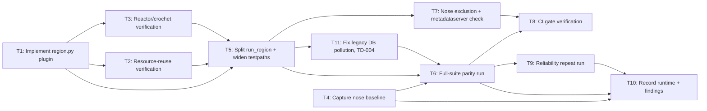

# Tasks: Migrate maasserver tests

> Requirements: @requirements.md
> Design: @design.md
> Status: Approved

## Requirement Coverage

| Requirement | Tasks | Notes |
|-------------|-------|-------|
| FR-001 | T4, T6 | Baseline capture (T4) + full-suite parity run (T6) |
| FR-002 | T5, T7 | Entry-point split + nose-exclusion/metadataserver-stability check |
| FR-003 | T6 | `git status --short` empty across all 338 files |
| FR-004 | T8 | CI gate (`utilities/run-py-tests-ci`, both legs) |
| FR-005 | T4, T10 | Baseline + post-migration runtime, recorded in `decisions.md` |
| FR-006 | T1, T2 | Resource-reuse mechanism + build-counter verification |
| FR-007 | T1, T3 | Reactor/crochet/thread-pool mechanism + real-file verification |
| NFR-001 | T9 | Reliability — repeated full-suite run consistency |
| NFR-002 | T2, T10 | Mitigation in place (T2), measured and recorded (T10) |

## Design Coverage Check

| Requirement | Design Coverage | Status | Notes |
|-------------|-----------------|--------|-------|
| FR-001 | design.md §3, §9, §15, TD-004 | Pass | TD-004 added at implementation time (T6 finding) |
| FR-002 | design.md §3 (`run_region()` split), TD-001 | Pass | |
| FR-003 | design.md §4 (no edits to test files), §15 | Pass | |
| FR-004 | design.md §15 Verification Strategy | Pass | |
| FR-005 | design.md §11 Observability/Operations | Pass | |
| FR-006 | design.md §3, TD-002, §16 | Pass | |
| FR-007 | design.md §3, TD-003, §16 | Pass | |
| NFR-001 | design.md §15 (repeat-run) | Pass | |
| NFR-002 | design.md §11, §14 Risks | Pass | |

## Implementation Readiness Check

| Check | Status | Notes |
|-------|--------|-------|
| Must Have requirements have tasks | Pass | FR-001, FR-002, FR-003, FR-004, FR-006, FR-007 all covered (table above) |
| Requirements are covered by design | Pass | design.md validated against 5 real files during design-phase spikes, not synthetic fixtures |
| Critical Questions are answered | Pass | `requirements.md` Questions: "None open"; both design-phase amendments (resource_reuse, reactor_setup) resolved with explicit user approval |
| Tasks have dependencies, acceptance criteria, files, and verification | Pass | see tasks below |
| Verification commands are known or marked manual/N/A | Pass | all commands explicit, several already dry-run during design-phase spikes |

## Implementation Slices

### MVP Slice

- **Goal:** `src/maasserver`'s full 338-file suite collects and passes
  under `bin/pytest` with outcomes identical to nose's current baseline,
  nose no longer runs any `maasserver` test, `src/metadataserver` is
  unaffected, and CI is green with the cutover in place.
- **User Stories:** US-001, US-002, US-003, US-004
- **Tasks:** T1-T10 (all; F03 is a single full-suite cutover per D-001,
  not sliceable into partial sub-phases)
- **Independent validation:** Each task's own verification step (below);
  overall slice is validated when the Readiness Check items all pass and
  T6's full-suite parity run matches T4's nose baseline exactly.

## Task Summary

| Task | Title | Priority | Estimate | Dependencies | Status |
|------|-------|----------|----------|--------------|--------|
| T1 | Implement `maastesting/pytest/region.py` and register its entry point | P0 | 2h | none | done |
| T2 | Verify the resource-reuse mechanism via build-count instrumentation | P0 | 1h | T1 | done |
| T3 | Verify the reactor/crochet/thread-pool fix against real `deferToDatabase` files | P0 | 1h | T1 | done |
| T4 | Capture the nose baseline for the full `maasserver` suite | P0 | 1h | none | done |
| T5 | Split `run_region()` and widen `pyproject.toml` `testpaths` | P0 | 1h | T1, T2, T3 | done |
| T6 | Full-suite collection and outcome parity run | P0 | 2h | T4, T5, T11 | pending |
| T7 | Verify nose exclusion and `src/metadataserver` stability | P0 | 30m | T5 | done |
| T8 | CI gate verification | P0 | 1h | T6, T7 | pending |
| T9 | Reliability check — repeated full-suite run consistency | P1 | 1h | T6 | pending |
| T10 | Record runtime measurements and findings in `decisions.md` | P1 | 30m | T4, T6, T9 | pending |
| T11 | Fix `DjangoTestCase`/`DjangoTransactionTestCase` database pollution (TD-004) | P0 | 1.5h | T5 | pending |

## Dependency Diagram

## Task T1: Implement `maastesting/pytest/region.py` and register its entry point

**Priority:** P0
**Estimate:** 2h
**Status:** done
**Covers:** FR-006, FR-007

### Overview

Create the new plugin module per design.md §3/§4: a `pytest_sessionstart`/
`pytest_sessionfinish` pair that (a) installs Twisted's thread-pools and
starts the reactor via `crochet.setup()` with `EventualResult` timeout
patching (mirroring `run_region()`'s existing setup, FR-007), and (b)
holds `MAASServerTestCase.resources`/`MAASTransactionServerTestCase.resources`'
shared `DjangoDatabasesManager` open for the life of the worker process
(FR-006). Register it as a new `pytest11` entry point.

### Work
- [x] Implement `pytest_sessionstart(session)` with deferred (in-function,
      not module-level) imports of `maastesting.scripts.init_asyncio_reactor`,
      `maasserver.utils.threads`/`orm`, `twisted.internet.reactor`,
      `crochet`, and `maasserver.testing.testcase`'s two test case classes —
      per design.md §3's documented `AppRegistryNotReady` constraint.
- [x] Call `init_asyncio_reactor()`, `threads.install_default_pool(maxthreads=1)`,
      `threads.install_database_unpool(maxthreads=1)`,
      `reactor.callFromThread(orm.disable_all_database_connections)`.
- [x] Apply the same `EventualResult` timeout-enforcement patch as
      `maastesting/noseplug.py`'s `Crochet` plugin, then call `crochet.setup()`.
- [x] For each of `MAASServerTestCase`, `MAASTransactionServerTestCase`:
      extract the shared `"databases"` manager from its `resources` tuple,
      call `getResource()` once, and keep a module-level reference.
- [x] Implement `pytest_sessionfinish(session, exitstatus)` calling
      `finishedWith()` on each held manager and clearing the reference list.
- [x] Add the `pytest11` entry point to `pyproject.toml`:
      `entry-points.pytest11.maas-region = "maastesting.pytest.region"`.
      Also added to the installed editable venv's dist-info metadata
      (no pip/build tool available in `.ve` to regenerate it, same
      constraint as F02's T1).
- [x] Add a copyright header per `AGENTS.md`.

### Acceptance Criteria
- [x] The new entry point is active without any conftest.py or explicit
      plugin flag. **PASS** — `--trace-config` output: `PLUGIN
      registered: <module 'maastesting.pytest.region' from
      '/project/src/maastesting/pytest/region.py'>`.
- [x] No edits to `maastesting/noseplug.py`, `maasserver/testing/resources.py`,
      or `maasserver/testing/testcase.py` (per Constraint and TD-003).
      **PASS** — `git status --short` confirms these 3 files untouched.

### Files
- `src/maastesting/pytest/region.py` — create
- `pyproject.toml` — modify (add entry point only; `testpaths` widening is T5)

### Verification
- [x] `bin/pytest --trace-config` lists the `maas-region` plugin as
      registered. **PASS**
- [x] `make lint` passes on the new file. **PASS** — `make lint` exit 0.

## Task T2: Verify the resource-reuse mechanism via build-count instrumentation

**Priority:** P0
**Estimate:** 1h
**Dependencies:** T1
**Status:** done
**Covers:** FR-006, NFR-002

### Overview

Prove T1's resource-holding mechanism actually prevents the per-test
rebuild tax, not just that tests pass — per design.md §15's build-counter
verification approach, reusing the design-phase spike's method.

### Work
- [x] Instrument `DjangoPristineDatabaseManager._make`/`DjangoDatabasesManager.make`
      with a temporary build counter (matching the design-phase spike
      technique), or use an equivalent non-invasive hook.
- [x] Run a multi-file set including both `MAASServerTestCase`
      (`assume_dirty=False`) and `MAASTransactionServerTestCase`
      (`assume_dirty=True`) subclasses — used `test_tag.py`,
      `test_config.py` (F02's scenario file), `test_security.py`
      (mixed) — under `bin/pytest` with T1's plugin active.
- [x] Confirm the pristine-template build count stays at 1 per worker
      process (not 1-per-test), and that `MAASTransactionServerTestCase`
      tests still correctly reset their own dirty resource per test.
      **PASS** — `{'pristine_build': 1, 'db_build': 5}` across 75 tests
      (3 files); `db_build=5` matches the 5
      `MAASTransactionServerTestCase` tests in `test_security.py`
      correctly resetting per-test, pristine build stayed at 1.
- [x] Repeat under `bin/pytest -n 2 --dist=load` and confirm each worker
      independently holds its own resource instance. **PASS** — both
      `gw0`/`gw1` reported `{'pristine_build': 1}` independently; 75
      passed.

### Acceptance Criteria
- [x] Pristine-template build count is 1 per worker process across the
      multi-file run (single-worker and `-n 2` modes). **PASS**
- [x] All tests in the sample set pass with correct per-test isolation
      (no leaked state between tests). **PASS** — 75/75 passed both runs.

### Files
- None (verification-only; instrumentation is temporary/local, not committed)

### Verification
- [x] Recorded build-count output from both single-worker and `-n 2
      --dist=load` runs, confirming the 1-per-worker invariant. **PASS**
      — single-worker: `{'pristine_build': 1, 'db_build': 5}`; xdist
      (2 workers): `{'pristine_build': 1}` on each of `gw0`/`gw1`.
- [x] All sampled tests pass. **PASS** — 75 passed, both modes.

## Task T3: Verify the reactor/crochet/thread-pool fix against real `deferToDatabase` files

**Priority:** P0
**Estimate:** 1h
**Dependencies:** T1
**Status:** done
**Covers:** FR-007

### Overview

Confirm T1's reactor/crochet/thread-pool installation produces correct
outcomes for `deferToDatabase`-dependent tests, using the design-phase
spike's validated file plus a broader sample of the 68 affected files.

### Work
- [x] Run `src/maasserver/tests/test_security.py` under `bin/pytest` with
      T1's plugin active; confirm all 4 tests pass (matching the
      design-phase spike and nose's baseline).
- [x] Identify a representative sample of `deferToDatabase`-using files
      in `src/maasserver` (`grep -rl deferToDatabase`: 33 test files
      found via direct grep, vs. design.md's 68 estimate — counting
      method difference, not a contradiction; not re-litigated here) and
      run a 5-file sample under `bin/pytest`; compare outcomes against
      nose's baseline for the same files.
- [x] Confirm zero source changes were required to any file in the sample.
      **PASS** — `git status --short src/maasserver` empty.

### Acceptance Criteria
- [x] `test_security.py`: 4/4 pass under pytest, matching nose's 4/4
      baseline (4/4 — this file alone has 4 tests; the 5-file sample
      below folds it in as one of 69 total).
- [x] Sampled set of `deferToDatabase` files (`test_security.py`,
      `test_nonces_cleanup.py`, `test_nodekey.py`,
      `test_publication.py`, `test_listener.py` — 5 files): outcomes
      match nose baseline exactly. **PASS** — pytest: 69 passed; nose
      per-file: 4+11+9+3+42 = 69, 0 failures either way.
- [x] `git status --short` is empty for all files touched by this
      task's verification runs. **PASS**

### Files
- None (verification-only; inspects existing files, no modifications)

### Verification
- [x] `bin/pytest -v src/maasserver/tests/test_security.py` (as part of
      the 5-file sample) — pass/fail/skip count matches nose's
      `bin/test.region`-scoped run exactly (4/4 both). **PASS**
- [x] Sampled `deferToDatabase` file set: pass/fail/skip counts match
      nose baseline. **PASS** — 69/69 both runners, 0 failures/skips
      either way.

## Task T4: Capture the nose baseline for the full `maasserver` suite

**Priority:** P0
**Estimate:** 1h
**Dependencies:** none
**Status:** done
**Covers:** FR-001, FR-005

### Overview

Record the current, pre-cutover nose baseline (collected test count,
per-test pass/fail/skip outcomes, and total runtime) for all of
`src/maasserver`, before any source change lands — this is the ground
truth T6 and T9 compare against, and must be captured first since T5's
`run_region()` edit removes nose's ability to produce it afterward.

### Work
- [x] Run `bin/test.region` (or nose scoped equivalently) against the
      full `src/maasserver` suite; capture the complete per-test
      outcome list (not just an aggregate count) and total wall-clock
      runtime.
- [x] Store the captured baseline (e.g. as a JUnit XML or structured log)
      in a location accessible for T6's comparison (local artifact;
      final summary goes into `decisions.md` via T10).

### Acceptance Criteria
- [x] Baseline includes total collected test count, full per-test
      pass/fail/skip outcome list, and total runtime. **PASS** —
      `bin/test.region --with-xunit --xunit-file=/tmp/f03_baseline/
      nose_baseline.xml src/maasserver` (explicit path argument,
      unaffected by T5's later `--select-dir` edit): `Ran 12024 tests
      in 1838.196s`, `OK`. XML confirms `tests="12024" errors="0"
      failures="0" skip="11"`.

### Files
- None (data capture only; no source changes)

### Verification
- [x] Baseline capture command and output are recorded for T6/T10's
      use. **PASS** — full per-test log at
      `/tmp/f03_baseline/nose_baseline.log` (12098 lines), structured
      JUnit XML at `/tmp/f03_baseline/nose_baseline.xml`.

## Task T5: Split `run_region()` and widen `pyproject.toml` `testpaths`

**Priority:** P0
**Estimate:** 1h
**Dependencies:** T1, T2, T3
**Status:** done
**Covers:** FR-002, FR-004

### Overview

Land the scope-mapping half of the cutover per design.md §3/TD-001: drop
`src/maasserver` from `run_region()`'s nose invocation, and widen
`pyproject.toml`'s `testpaths` so `bin/pytest` (no explicit path
argument) picks up `src/maasserver` alongside `src/tests`.

### Work
- [x] Edit `run_region()` in `src/maastesting/scripts.py`: remove
      `--select-dir=src/maasserver` and its `--cover-package` entry;
      leave `--select-dir=src/metadataserver` and `run_region_legacy()`
      unchanged (per design.md TD-001, confirmed inert for `legacy`).
- [x] Edit `pyproject.toml`'s `[tool.pytest.ini_options] testpaths` from
      `["src/tests"]` to `["src/tests", "src/maasserver"]`.

### Acceptance Criteria
- [x] `run_region()`'s nose invocation no longer references
      `src/maasserver`; `src/metadataserver`'s line is untouched.
      **PASS** — `grep` confirms line 53-54 is metadataserver-only;
      `run_region_legacy()` (line 94-96) untouched.
- [x] `bin/pytest` with no path argument collects tests from both
      `src/tests` and `src/maasserver`. **PASS** — bare
      `--collect-only -q` yields 12434 `maasserver/` nodeids.

### Files
- `src/maastesting/scripts.py` — modify (`run_region()` only)
- `pyproject.toml` — modify (`testpaths`)

### Verification
- [x] `bin/pytest --collect-only -q` (no path argument) includes
      `src/maasserver` nodeids. **PASS**
- [x] `make lint` passes. **PASS**

## Task T6: Full-suite collection and outcome parity run

**Priority:** P0
**Estimate:** 2h
**Dependencies:** T4, T5, T11
**Covers:** FR-001, FR-003

### Overview

Run the full, now-included `src/maasserver` suite under `bin/pytest`
and compare against T4's nose baseline — per-test outcome parity, not
just aggregate pass count, per FR-001's "zero behavioral change"
requirement.

### Work
- [ ] Run `bin/pytest -n auto --dist=load src/maasserver` (or the
      project's standard full invocation) and capture the complete
      per-test outcome list and collected test count.
- [ ] Compare collected test count against T4's nose baseline count.
- [ ] Compare per-test pass/fail/skip outcome against T4's baseline,
      test by test, not just aggregate totals.
- [ ] Confirm `git status --short` is empty across all
      `src/maasserver/**/test_*.py` files (FR-003 — no source changes
      required).

### Acceptance Criteria
- [ ] Collected test count matches T4's nose baseline exactly.
- [ ] Every test's pass/fail/skip outcome matches T4's baseline exactly.
- [ ] Zero source changes to any `maasserver` test file.

### Files
- None (verification-only)

### Verification
- [ ] Collected-count diff (pytest vs. nose baseline) is zero.
- [ ] Per-test outcome diff (pytest vs. nose baseline) is empty.
- [ ] `git status --short src/maasserver` is empty.

## Task T7: Verify nose exclusion and `src/metadataserver` stability

**Priority:** P0
**Estimate:** 30m
**Dependencies:** T5
**Status:** done
**Covers:** FR-002, Constraint

### Overview

Confirm T5's `run_region()` edit achieved exactly its intended effect:
`maasserver` is gone from nose, `metadataserver` is unaffected — per
US-002's acceptance criteria and the Constraint.

### Work
- [x] Run `bin/test.region` after T5's edit; confirm zero
      `src/maasserver`-path tests appear in its output.
- [x] Confirm `src/metadataserver`'s suite still runs under nose and
      produces the same pass/fail counts as its pre-F03 baseline.

### Acceptance Criteria
- [x] Nose's output contains zero `maasserver` test results. **PASS**
      — `grep -c "^maasserver\."` on full `bin/test.region` output: 0.
- [x] `metadataserver`'s nose results are unchanged from pre-F03
      baseline. **PASS** — pre-F03 baseline: `Ran 989 tests ... OK`;
      post-T5: `Ran 989 tests in 173.338s ... OK` — identical count,
      same outcome.

### Files
- None (verification-only)

### Verification
- [x] `bin/test.region` output: zero `maasserver` entries, `metadataserver`
      pass/fail counts match pre-F03 baseline. **PASS**

## Task T8: CI gate verification

**Priority:** P0
**Estimate:** 1h
**Dependencies:** T6, T7
**Covers:** FR-004

### Overview

Confirm both of CI's required test jobs pass with the full cutover
(T1, T5) in place, per US-003's acceptance criteria.

### Work
- [ ] Run `utilities/run-py-tests-ci` (or its two constituent commands,
      `bin/test.parallel` and `bin/pytest`, directly if the full script
      isn't practical to run locally).
- [ ] Confirm both legs exit successfully.

### Acceptance Criteria
- [ ] `bin/test.parallel` (nose) passes.
- [ ] `bin/pytest` passes, including `src/maasserver`.

### Files
- None (verification-only)

### Verification
- [ ] Both CI legs exit 0.

## Task T9: Reliability check — repeated full-suite run consistency

**Priority:** P1
**Estimate:** 1h
**Dependencies:** T6
**Covers:** NFR-001

### Overview

Confirm the migrated suite introduces no flakiness, per NFR-001 and
F01/F02's established reliability standard — re-run T6's full-suite
pytest run and compare counts.

### Work
- [ ] Re-run `bin/pytest -n auto --dist=load src/maasserver` a second
      time.
- [ ] Compare collected/pass/fail/skip counts between T6's run and this
      repeat run.

### Acceptance Criteria
- [ ] Both runs report identical collected/pass/fail/skip counts.

### Files
- None (verification-only)

### Verification
- [ ] Count diff between T6's run and this repeat run is empty.

## Task T10: Record runtime measurements and findings in `decisions.md`

**Priority:** P1
**Estimate:** 30m
**Dependencies:** T4, T6, T9
**Covers:** FR-005, NFR-002

### Overview

Record the nose baseline and post-migration pytest-xdist runtime for
the `maasserver` suite in a durable location, per FR-005/D-003, and
confirm the already-drafted `decisions.md` findings (resource-reuse,
reactor/crochet) reflect final implementation-time verified evidence,
not only design-phase spike data — mirroring F01/F02's precedent.

### Work
- [ ] Append the nose baseline runtime (T4) and the pytest-xdist
      post-migration runtime (T6) to `decisions.md`.
- [ ] Confirm/update `decisions.md`'s existing resource-reuse and
      reactor/crochet findings with implementation-time evidence (T2, T3)
      if it differs from or extends the design-phase spike data already
      recorded.
- [ ] Cross-reference `decisions.md` from `design.md` §11 if not already
      pointing to the final evidence.

### Acceptance Criteria
- [ ] `decisions.md` contains both runtime numbers (nose baseline,
      pytest-xdist post-migration).
- [ ] Resource-reuse and reactor/crochet findings reflect implementation-
      time verification (T2/T3), not only design-phase spikes.

### Files
- `.ai/sdd/specs/003-migrate-maasserver-tests/decisions.md` — modify
- `.ai/sdd/specs/003-migrate-maasserver-tests/design.md` — modify (§11,
  cross-reference if needed)

### Verification
- [ ] Manual review: `decisions.md` content is consistent with T2/T3/T4/
      T6/T9's actual recorded results.

## Task T11: Fix `DjangoTestCase`/`DjangoTransactionTestCase` database pollution (TD-004)

**Priority:** P0
**Estimate:** 1.5h
**Dependencies:** T5
**Status:** pending
**Covers:** FR-001, FR-003 (TD-004)

### Overview

T6's first run surfaced a design gap (design.md §3 Amendment, TD-004):
`DjangoTestCase`/`DjangoTransactionTestCase` (used by
`src/maasserver/tests/test_fields.py`,
`src/maasserver/models/tests/test_cleansave.py`,
`src/maasserver/utils/tests/test_signals.py`,
`src/maasserver/models/tests/test_timestampedmodel.py`) have no
`resources` tuple of their own and silently operate against
`MAASServerTestCase`'s shared, held-open database connection under
pytest, causing cross-test data pollution (confirmed: 183 failed/28
errored at full-suite scale, reproduced in a single process with no
xdist). Give them a dedicated `DjangoDatabasesManager` instance to fix
this per TD-004.

### Work
- [ ] Add `resources = (("databases", DjangoDatabasesManager(assume_dirty=True)),)`
      to both `DjangoTestCase` and `DjangoTransactionTestCase` in
      `maastesting/djangotestcase.py`, importing `DjangoDatabasesManager`
      from `maasserver.testing.resources` (deferred import if needed to
      avoid `AppRegistryNotReady`, matching the pattern already used in
      `maastesting/pytest/region.py`).
- [ ] Use a **new** `DjangoDatabasesManager` instance, distinct from
      `MAASServerTestCase.resources`/`MAASTransactionServerTestCase.resources`'
      shared instances, so the two class families never resolve to the
      same resource.
- [ ] Re-run the minimal repro (`test_node.py` + `test_signals.py` in
      one process) and confirm it now passes.
- [ ] Re-run the 4 confirmed-affected files
      (`test_fields.py`, `test_cleansave.py`, `test_signals.py`,
      `test_timestampedmodel.py`) standalone and alongside
      `MAASServerTestCase`-based files in the same process; confirm
      all pass with no pollution.
- [ ] Confirm `bin/test.region.legacy` (nose, unaffected by this
      change) still passes all 69 tests unchanged.

### Acceptance Criteria
- [ ] The two-test minimal repro (previously failing) passes.
- [ ] All 4 confirmed-affected files pass standalone and when run
      alongside `MAASServerTestCase`/`MAASTransactionServerTestCase`
      files in the same process.
- [ ] `bin/test.region.legacy` still passes 69/69, unchanged.
- [ ] `make lint` passes on the edited file.

### Files
- `maastesting/djangotestcase.py` — modify (add `resources` tuples per
  TD-004)

### Verification
- [ ] Minimal repro command passes (previously failed).
- [ ] 4-file affected-file set passes standalone and combined with
      `MAASServerTestCase` files.
- [ ] `bin/test.region.legacy` output: 69/69 passed, unchanged.
- [ ] `make lint` exit 0.

## Completion Rules

- Do not mark a task complete without implementation and verification
  evidence.
- Tests and verification belong inside each implementation task; no
  separate testing-only task beyond what is already merged above.
- If a task reveals a requirements or design gap (e.g. a file not
  covered by T1's two held resource managers, or an unexpected outcome
  mismatch in T6), stop and resolve it through the proper gate before
  proceeding.
