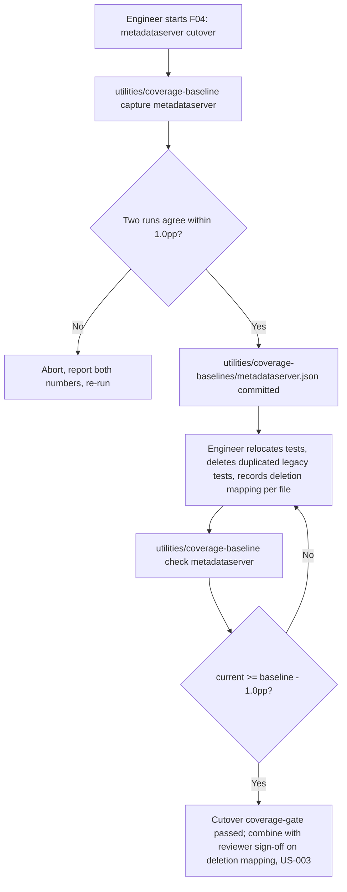

# Design: Coverage baseline harness

> Requirements: @requirements.md
> Status: Approved

## 1. Summary

A new Python script, `utilities/coverage-baseline`, with two subcommands:

- `capture <package>`: runs that package's legacy (nose) suite and the
  full pytest suite under `coverage run`, combines the data, filters it to
  the package's own source tree, repeats the whole pass a second time, and
  — only if the two runs agree within the tolerance band — writes the
  accepted number to a committed JSON file under
  `utilities/coverage-baselines/<package>.json`.
- `check <package>`: runs only the pytest suite (no nose — this is what a
  cut-over package uses) under `coverage run`, filters to the package's
  source tree, compares against the committed baseline, and prints a
  pass/fail verdict with exact delta. Exits non-zero on fail.

This reuses the coverage mechanism already configured in `pyproject.toml`
(`run.branch = true`, `run.source = ["src"]`) and already proven working
end-to-end during requirements-gathering (a single-file smoke run produced
a real `coverage report`/`coverage json` with populated branch columns).
It does not touch `utilities/run-tests-coverage` (that script serves the
unrelated TiCS upload job) or `run-py-tests-ci` (the permanent PR gate,
per D-002 explicitly out of scope).

## 2. Requirements Mapping

| Requirement | Design Coverage |
|-------------|-----------------|
| FR-001 | §3 `capture`, §4 `_run_suite`/`_combine`, §13 TD-001 |
| FR-002 | §3 `_package_totals` (`coverage json --include=<pkg-glob> --omit=<test-globs>`), §13 TD-002, TD-004 |
| FR-003 | §3 `capture`'s two-pass-and-compare loop, §9 Edge Cases |
| FR-004 | §3 `check`, §6 exit codes |
| FR-005 | §12 Migration/Rollout (deletion-mapping convention; not enforced by this tool, per Out of Scope) |
| FR-006 | §12 Migration/Rollout (capture order: all three packages before F04 starts) |
| NFR-001 | §13 TD-001 (two-run stability check), §14 Risks |
| NFR-002 | §6 output format |

## 3. Technical Approach

One script, two subcommands, sharing a small internal library of three
functions:

```python
def _run_suite(package: str, legacy: bool, coverage_file: Path) -> None:
    """Run the package's test suite(s) under `coverage run`, writing to
    `coverage_file`. `legacy=True` also runs the nose leg; `legacy=False`
    runs pytest only."""

def _combine(coverage_files: list[Path], into: Path) -> None:
    """`coverage combine --keep` the given data files into one."""

def _package_totals(coverage_file: Path, package: str) -> dict:
    """`coverage json --include=src/<package>/*
    --omit=*/tests/*,*/test_*.py -o -` against `coverage_file`, parsed,
    returning the `totals` dict (same shape coverage.py itself
    produces — percent_covered, num_statements, num_branches, etc.).
    Test files are omitted so the metric tracks production code only
    (TD-004)."""
```

`capture <package>`:

1. Map `package` to its suite command(s) (§4 table).
2. Run the full pass (legacy + pytest, combined) **twice**, each into its
   own temp data file, each immediately reduced to that package's
   `_package_totals()`.
3. Compare the two runs' `percent_covered`. If they differ by more than
   1.0pp (D-003's tolerance, reused per NFR-001 rather than inventing a
   second constant), abort with the two numbers shown — FR-003.
4. If stable, take the **minimum** of the two runs (TD-001) as the
   accepted baseline.
5. Write `utilities/coverage-baselines/<package>.json` (schema in §5).

`check <package>`:

1. Load the committed baseline file and reject it (exit 2) if its
   `metric_version` differs from the tool's — before running anything,
   so a stale baseline costs seconds rather than a full suite run
   (TD-004).
2. Run the pytest-only pass for `package` (no nose leg — matches FR-004's
   "pytest-only run").
3. Compute `_package_totals()`.
4. Pass if `current.percent_covered >= baseline.percent_covered - 1.0`,
   else fail.
5. Print the four required numbers (NFR-002) and exit 0/1.

## 4. Component / Module Structure

```text
utilities/coverage-baseline            # new script, capture + check subcommands
utilities/coverage-baselines/          # new directory, committed JSON, one file per package
  provisioningserver.json
  metadataserver.json
  maasserver.json
```

No changes to `maastesting/`, `pyproject.toml`, `Makefile`, or any
existing `utilities/*` script — this is additive only, confirmed by the
Out of Scope section (no permanent-gate wiring).

Suite-selection table (`_run_suite`'s `legacy=True` branch):

| Package | Legacy suite command | Pytest suite command |
|---------|----------------------|----------------------|
| `provisioningserver` | `.ve/bin/test.rack` | `.ve/bin/pytest src/tests` |
| `metadataserver` | `.ve/bin/test.region` (runs maasserver+metadataserver together — nose has no metadataserver-only entry point) | `.ve/bin/pytest src/tests` |
| `maasserver` | `.ve/bin/test.region` (same combined invocation) | `.ve/bin/pytest src/tests` |

The pytest suite command is always the full `src/tests` run, not a
package subset — F02's requirement is to attribute coverage *at report
time* (`--include`), not to partition which tests execute. This matches
how `coverage.py` itself already works (confirmed: `--include` on a
combined data file correctly isolates one package's lines, verified
against real `src/maasserver` vs `src/metadataserver` filters producing
different, correct totals).

`bin/test.region.legacy` is **not** included: confirmed zero test classes
currently subclass `DjangoTestCase`/`DjangoTransactionTestCase`
(`MAASLegacyServerTestCase` has no subclasses in `maasserver` or
`metadataserver` today), so it contributes nothing to any baseline.

## 5. Data Model / State

`utilities/coverage-baselines/<package>.json`:

```json
{
  "package": "provisioningserver",
  "metric_version": 2,
  "captured_at": "2026-11-16T00:00:00Z",
  "percent_covered": 42.17,
  "num_statements": 12345,
  "num_branches": 2345,
  "stability_runs": [42.17, 42.31],
  "tolerance_pp": 1.0
}
```

- `percent_covered`: the accepted baseline, equal to
  `min(stability_runs)` (TD-001).
- `stability_runs`: both raw numbers from the two-pass check (FR-003),
  kept for audit — a reviewer can see the actual spread, not just the
  accepted value.
- `tolerance_pp`: the value used at capture time, stored alongside the
  number it was validated against, so a later change to the global
  tolerance doesn't silently invalidate old baselines without being
  visible in a diff.
- `metric_version`: what the number measures (TD-004). `check` exits 2
  rather than comparing across versions, since a baseline captured under
  a different filter is not comparable. Absent means version 1.

No database, no migration — three small JSON files, committed to git like
any other fixture.

## 6. API / Integration Contract

Command-line only:

```text
utilities/coverage-baseline capture <provisioningserver|metadataserver|maasserver>
utilities/coverage-baseline check   <provisioningserver|metadataserver|maasserver>
```

`check` output (NFR-002):

```text
package:    provisioningserver
baseline:   42.17%
current:    41.98%
delta:      -0.19pp
tolerance:  1.0pp
verdict:    PASS
```

Exit codes: `0` = pass, `1` = fail (coverage regression beyond
tolerance), `2` = usage/environment error (e.g. baseline file missing or
captured under a different `metric_version`, suite failed to run) —
distinguished so a script invoking this can tell "coverage regressed"
apart from "something is broken," per US-002's acceptance criterion that
the tool is "usable in a script."

## 7. Security / Permissions / Privacy

Not applicable — local developer tooling, no network calls, no secrets,
reads/writes only within the repo tree.

## 8. User Flows



## 9. Edge Cases

| Case | Expected Behavior |
|------|--------------------|
| `capture` run twice, second run differs by > 1.0pp | Abort, print both percentages and the delta, exit 2. No baseline file written or overwritten (FR-003). |
| `capture` run on a package whose baseline file already exists | Overwrite only on explicit re-run; the tool does not silently refuse — re-capturing is a legitimate action if source code genuinely changed before a cutover started. No special flag; `capture` always (re)writes after a stable pass. |
| `check` run before a baseline exists for that package | Exit 2 with a clear "no baseline — run `capture` first" message, not a crash or a silent 0% comparison. |
| `check` run against a baseline captured under an older `metric_version` | Exit 2 before running any suite, naming both versions and the `capture` command that fixes it (TD-004). Comparing across filters would produce a meaningless number, so the tool refuses rather than printing one. |
| `check` run on `metadataserver` or `maasserver` — nose's `test.region` always runs both together; pytest-only baseline for one must not accidentally include the other's regression | Not an issue: `_package_totals` filters by `src/<package>/*` at report time regardless of which suites fed the combined data file; metadataserver's number is never affected by maasserver-only test changes and vice versa (verified: separate `--include` filters on the same combined data file produced independent, correct totals). |
| A package's suite fails outright (e.g. DB not running, binary not built) | `_run_suite` distinguishes "suite completed, some tests failed" from "suite did not complete": if `coverage_file` exists and is non-empty after the subprocess returns, `_run_suite` tolerates a non-zero exit (pytest exit 1 / nose or Django `manage.py test` exit 1 both mean "tests failed, run completed") — coverage data from a completed run is still valid regardless of individual test outcomes (NFR-001: pre-existing unrelated failures, e.g. 2 out of ~7,949 pytest tests, must not block every package's baseline). If `coverage_file` is missing or empty after the subprocess returns (crash before any test ran, DB connection refused, binary not found), `_run_suite` aborts with exit 2 and the suite's own error output — this is the only case that still aborts. |
| `coverage combine` finds no data files (suite produced none) | `coverage combine` itself errors in this case; propagated as exit 2, not swallowed. |

## 10. Accessibility / UX Notes

Not applicable — CLI tool for engineers, plain text output (§6).

## 11. Observability / Operations

- `capture`/`check` print which suite commands they are running and their
  live output passes through (not captured/hidden), so a hung DB-cluster
  setup or a slow nose run is visible, not silent.
- No logging infrastructure beyond stdout/stderr — this is a short-lived
  migration tool (D-002), not a monitored service.

## 12. Migration / Rollout

- **Capture order (FR-006):** all three baselines
  (`provisioningserver`, `metadataserver`, `maasserver`) must be captured
  and committed before F04 (the first cutover feature) begins deleting or
  relocating any test. This is a one-time setup step for this feature,
  not an ongoing process.
- **Deletion-mapping convention (FR-005):** this tool does not enforce or
  store the mapping — per Out of Scope, that format is each cutover
  feature's own design decision (e.g. a `decisions.md` entry per deleted
  file, or a PR-description table). This design only guarantees the
  coverage number `check` reports cannot by itself be read as "cutover
  complete" — US-003's acceptance criterion is a process requirement on
  the cutover features, not a mechanism this script can enforce in code.
- **Rollback:** deleting `utilities/coverage-baseline` and
  `utilities/coverage-baselines/` fully removes this feature with no
  trace elsewhere in the repo — nothing else imports or depends on it
  until F04 starts using it.

## 13. Technical Decisions

### TD-001: Accepted baseline is the minimum of the two stability-check runs

- **Decision:** `capture`'s accepted `percent_covered` is
  `min(run1, run2)`, not the average.
- **Why:** The baseline exists to be a gate later packages must meet; a
  conservative (lower) accepted value means `check` can only get *harder*
  to pass from noise, never easier. An average could let an unlucky-low
  `check` run pass against an inflated average baseline.
- **Trade-off:** Slightly stricter than necessary if the true coverage is
  the higher of the two numbers.
- **Alternatives considered:** Average (rejected — see above); require a
  third run to break ties (rejected — doubles cost for marginal benefit
  on a two-run spread already bounded by the 1.0pp tolerance).

### TD-002: Per-package attribution by `--include` filter on one shared data file, not separate suite runs per package

- **Decision:** Run the full pytest suite and the relevant nose suite(s)
  once per capture/check invocation; attribute to a specific package by
  filtering the resulting combined coverage data with
  `coverage json --include=src/<package>/*`, not by scoping which tests
  execute.
- **Why:** Verified directly: filtering the same combined data file with
  different `--include` globs (`src/maasserver/*` vs
  `src/metadataserver/*`) produced independently correct totals. Nose's
  own `run_region()` has no metadataserver-only or maasserver-only entry
  point — it always selects both directories together — so scoping
  execution per package is not even available for those two without
  editing `maastesting/scripts.py`, which is out of scope for this
  feature.
- **Trade-off:** Each `capture`/`check` run pays the cost of running the
  *entire* pytest suite (`src/tests`, 4,085+ tests) even when only one
  package's number is needed. Acceptable for a migration-duration tool
  run a handful of times per package, not per-commit.
- **Alternatives considered:** Edit `maastesting/scripts.py` to add
  per-package nose entry points (rejected — touches shared legacy
  machinery for a tool with a ~1-year lifespan, against the plan's
  explicit anti-over-engineering constraint); run pytest scoped to
  `src/tests/<package>` only (rejected — undercounts, since coverage
  contributions to a package's source can come from tests anywhere in
  `src/tests`, e.g. integration-style tests).

### TD-003: Plain argparse script, not a new CLI framework or `Makefile` target

- **Decision:** `utilities/coverage-baseline` is a standalone Python
  script using the standard library (`argparse`, `subprocess`, `json`),
  matching the style of existing `utilities/*.py` scripts
  (`mark_lp_bug_fix_committed.py`, `generate_builders.py`).
- **Why:** No existing CLI framework convention to match in `utilities/`;
  introducing one for a migration-duration tool is unjustified weight.
- **Trade-off:** No shell-completion or `--help` polish beyond argparse's
  defaults.
- **Alternatives considered:** `click`/`typer` (rejected — new dependency
  for a short-lived tool); a `Makefile` target wrapping a bash script
  (rejected — the JSON parsing and tolerance-comparison logic is
  materially simpler in Python than bash, and this script needs no
  Makefile integration since D-002 keeps it out of `make test`).

### TD-004: Measure production code only, versioned so stale baselines are rejected

- **Decision:** `_package_totals` adds `--omit=*/tests/*,*/test_*.py` to
  TD-002's `--include` filter, and baselines carry a `metric_version`
  (now 2) that `check` refuses to compare across.
- **Why:** Found during F05 T6. coverage.py expands a trailing `/*`
  recursively (`coverage/files.py:347-365`), so TD-002's filter counted
  a package's own test files as measured source. Test files are ~100%
  self-covered while their suite runs and 0% once it stops — so a
  cutover that relocates tests out of `src/<pkg>/` craters the number
  with no production code changing. For `provisioningserver`, 14,231 of
  28,549 counted statements were test files: half the metric was noise,
  and it reported `-66.19pp` FAIL on a tree whose production coverage
  had in fact improved (+0.16pp like-for-like). A gate that fails this
  loudly on a healthy tree trains its readers to ignore it, which is
  worse than having no gate.
- **Trade-off:** Invalidates all three committed v1 baselines. They are
  recaptured at the start of each package's own cutover feature rather
  than upfront (~25min each), since a package's number is only
  actionable while its cutover is in flight. `check` exits 2 with a
  recapture instruction *before* running any suite, so a stale baseline
  costs seconds, not a 13-minute run.
- **Alternatives considered:** Leave the filter and document the
  limitation (rejected — every remaining cutover would reproduce the
  same false FAIL and need the same manual re-litigation that T6 did);
  recapture all three baselines immediately (rejected — F06 changes
  `maasserver`'s tree anyway, so its baseline would be captured twice).

## 14. Risks

| Risk | Impact | Mitigation |
|------|--------|------------|
| Full pytest suite run (4,085+ tests) makes each `capture`/`check` invocation slow, discouraging engineers from re-running it when they should | Low | Accepted — this is a migration-duration tool (D-002), run a handful of times per package, not per-commit; matches the plan's own framing that speed is not a goal here. |
| `coverage combine --keep` silently mis-merges if two suite runs overlap on the same source lines in incompatible ways | Low | Verified empirically: combining two independent suite runs (pytest + nose) into one data file and filtering produced correct, additive totals; no observed anomaly in testing. |
| A baseline captured today becomes stale if unrelated source changes land on `main` before a cutover actually starts | Medium | FR-006 only requires capture "before F04-F07 begins deleting or relocating tests" — if significant drift occurs, re-running `capture` before starting the cutover is the explicit, supported recovery path (see Edge Cases §9). |
| Minimum-of-two (TD-001) can still be an unlucky low outlier if both runs happen to dip together | Low | Accepted trade-off, stated in TD-001; a third confirmatory run is not required given the 1.0pp tolerance already bounds the spread. |
| Running `capture`/`check` for two packages concurrently corrupts both: `src/maastesting/pytest/database.py`'s `templatemaasdb` fixture drops/rebuilds a shared Postgres template DB (`maas_test_master`) per pytest session, so a concurrent second run can pull it out from under the first (observed: `asyncpg.exceptions.InvalidCatalogNameError: database "maas_test_master" does not exist` mid-run) | High (observed, not theoretical) | `utilities/coverage-baseline` does not serialize or lock against concurrent invocations — it is the invoking engineer's responsibility to run one `capture`/`check` at a time against a given Postgres cluster. Documented here, not enforced in code (same stance as FR-005 in §12). |

## 15. Verification Strategy

- **Unit/component:** Not applicable in the traditional sense — this
  feature *is* a test-verification tool. Its own correctness is verified
  by running it against the real repo (next bullet), not by a unit-test
  suite wrapping it (would be testing a test tool with a test tool, and
  the FRs are about producing correct numbers against real suites, not
  about internal logic worth isolating).
- **Integration/manual:** `capture` run against all three packages,
  confirming: (a) two-run stability check accepts or rejects correctly
  (verify by comparing printed deltas against the JSON file written),
  (b) `_package_totals` numbers match a manual `coverage report
  --include=` run side-by-side, (c) `check` run immediately after
  `capture` reports a correctly-computed current/baseline/delta and the
  verdict that those numbers imply. **Not** "PASS with ~0 delta" for a
  package that has not yet been cut over: `check` is pytest-only by
  design (§3), while `capture`'s baseline for an uncut package is
  nose+pytest combined — a large FAIL (pytest alone covers only the
  handful of files already under `src/tests/<package>/`) is the correct,
  expected result until that package's cutover feature (F04-F07)
  actually relocates its tests. `check` only reports PASS-with-~0-delta
  once a package is cut over (§8 User Flow: `capture` → relocate tests →
  `check`), which is each cutover feature's concern, not this feature's.
  Note (TD-004): even *after* a cutover, the number stays depressed for
  any package that retains a nose-only carve-out, since production
  modules exercised solely by those tests look unexercised to a
  pytest-only run. Omitting test files removes the self-coverage noise
  but not this; F05 T6 quantified the gap by combining the nose leg back
  in (27.83% → 93.22% for `provisioningserver`). Read a post-cutover
  FAIL against the size of the package's remaining carve-out before
  treating it as a regression.
- **Build/lint:** `make lint` (Ruff) over the new script; no other build
  step applies.

## 16. Implementation FAQ

**Q:** Why does `check` not also run the nose suite, when `capture` does?
**A:** `check` is run *after* a package's cutover, when (per the plan)
nose no longer runs that package's tests at all — FR-004 explicitly says
"pytest-only run." Running nose in `check` would either fail (tests
relocated) or report stale numbers.

**Q:** What happens to `provisioningserver`'s baseline if `maasserver`
test code changes in the same combined coverage data (since nose's
`run_region()` always touches both maasserver and metadataserver
together)?
**A:** `provisioningserver` is captured via `test.rack`, a fully separate
invocation from `test.region` — no shared data file with maasserver/
metadataserver at all. Only `metadataserver` and `maasserver` share a
nose invocation, and TD-002 confirms `--include` filtering separates them
correctly regardless.

**Q:** Why commit `stability_runs` (both numbers) instead of just the
accepted baseline?
**A:** US-003/FR-005's spirit — this is a migration gate that must be
auditable, not just a boolean. A reviewer later asking "was this baseline
ever flaky?" can see the actual two numbers without re-running anything.

**Q:** Does this tool do anything about the `Makefile`'s `bin/` symlinks
being unbuilt (`bin/test.region` missing, only `.ve/bin/test.region`
exists)?
**A:** No — it invokes `.ve/bin/test.region` and `.ve/bin/pytest`
directly (the paths confirmed to actually work), sidestepping the
unbuilt `bin/` symlink question entirely. Fixing that symlink gap is out
of scope for this feature.
