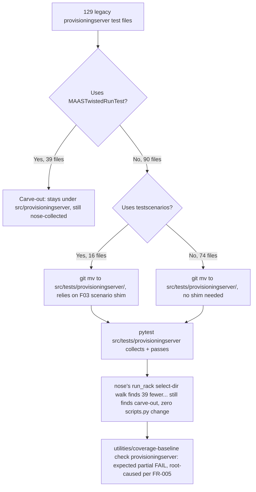

# Design: Cut over `provisioningserver` to pytest (F05)

> Requirements: @requirements.md
> Status: Approved

## 1. Summary

Relocate the 90 migratable `provisioningserver` legacy test files (72
gap-free + 18 scenario-gap) from `src/provisioningserver/**/tests/` to
their mirrored paths under `src/tests/provisioningserver/`, unchanged
except where F03's existing `testscenarios` shim requires no file
change at all (it is a pytest-plugin-side mechanism). The 39
`MAASTwistedRunTest` carve-out files (D-002) are left exactly where
they are; `nose`'s `run_rack()` uses whole-directory auto-discovery
(`--select-dir=src/provisioningserver`), so once the 90 migratable
files are physically moved out of that tree, `nose` stops collecting
them with **zero change to `maastesting/scripts.py`** — a materially
simpler cutover mechanism than F03's (which had to delete a
`--select-dir` line once a directory emptied out completely).

## 2. Requirements Mapping

| Requirement | Design Coverage |
|-------------|-----------------|
| FR-001 | §3 Gap-free relocation, §4 file list |
| FR-002 | §3 Scenario-gap relocation (F03 shim reuse), §4 file list |
| FR-003 | §9 Edge Cases (FIPS files), §4 FIPS cross-reference |
| FR-004 | §3 `nose` narrowing via physical relocation, §13 TD-001 |
| FR-005 | §15 Verification Strategy, §9 Edge Cases (expected partial-coverage FAIL) |
| FR-006 | §9 Edge Cases (`test_utils.py` basename, confirmed no path collision) |
| FR-007 | §4 carve-out file list, §12 Migration/Rollout |
| NFR-001 | §15 Verification Strategy (double-run discipline) |
| NFR-002 | §1, Out of Scope cross-reference (no style changes) |

## 3. Technical Approach

Three-step mechanical move, no new plugin/shim code (F03's shim is
reused as-is, zero changes):

1. **Relocate 72 gap-free files** (§4 list) to their mirrored path
   under `src/tests/provisioningserver/`, verbatim (`git mv`). No
   dependency on any pytest plugin — these already pass under stock
   pytest collection today (confirmed no `scenarios`, no
   `run_tests_with`).
2. **Relocate 18 scenario-gap files** (§4 list) the same way. F03's
   `maastesting/pytest/scenarios.py` plugin (`ScenarioUnitTestCase`)
   is already registered globally (via `pytest11` entry points,
   confirmed in F03's investigation) and requires no per-package
   wiring — these files pass once moved, exactly as F03 proved for
   `maasserver`'s own scenario files.
3. **Leave the 39 carve-out files in place.** No file move, no source
   edit. `run_rack()`'s `--select-dir=src/provisioningserver` continues
   to find them via `nose`'s normal directory walk; it simply finds 90
   fewer files than before, since those have physically moved out of
   the tree it walks.

No changes to `maastesting/scripts.py`, `maastesting/noseplug.py`, or
any F03 plugin code. This differs from F03's own cutover (which edited
`run_region()` to drop a `--select-dir` line once `maasserver`
contributed zero remaining files) only because `provisioningserver`
does **not** reach zero remaining files — the carve-out means
`--select-dir=src/provisioningserver` must stay exactly as-is,
permanently (until the follow-up work tracked by FR-007 eventually
closes the carve-out too).

## 4. Component / Module Structure

```text
src/provisioningserver/**/tests/test_*.py   # 129 files today
  -> 72 gap-free files:        git mv to src/tests/provisioningserver/**/
  -> 18 scenario-gap files:    git mv to src/tests/provisioningserver/**/
  -> 39 MAASTwistedRunTest carve-out files:  UNCHANGED, stay in place
```

Gap-free files (72): every `test_*.py` under
`src/provisioningserver/**/tests/` not listed in either table below.

Scenario-gap files (18, FR-002 — corrected from design time's 16 per
TD-002/requirements.md D-003: `tests/test_config.py` and
`utils/tests/test_config.py` were missed by the original narrower
candidate-pool grep, found by T1's full re-grep at implementation
time):

```text
src/provisioningserver/boot/tests/test_pxe.py
src/provisioningserver/drivers/power/tests/test_ipmi.py          [FIPS]
src/provisioningserver/drivers/tests/test_base.py
src/provisioningserver/logger/tests/test__tftp.py
src/provisioningserver/logger/tests/test__twisted.py
src/provisioningserver/logger/tests/test_logger.py
src/provisioningserver/rpc/tests/test_docs.py
src/provisioningserver/tests/test_config.py
src/provisioningserver/tests/test_path.py
src/provisioningserver/utils/tests/test_config.py
src/provisioningserver/utils/tests/test_fs.py
src/provisioningserver/utils/tests/test_ps.py
src/provisioningserver/utils/tests/test_text.py
src/provisioningserver/utils/tests/test_tftp.py
src/provisioningserver/utils/tests/test_url.py
src/provisioningserver/utils/tests/test_utils.py
src/provisioningserver/utils/tests/test_version.py
src/provisioningserver/utils/tests/test_xpath.py
```

Carve-out files (39, FR-007, D-002) — complete list, confirmed via
`run_tests_with = MAASTwistedRunTest.make_factory(...)` grep:

```text
src/provisioningserver/boot/tests/test_boot.py
src/provisioningserver/boot/tests/test_windows.py
src/provisioningserver/dhcp/tests/test_detect.py
src/provisioningserver/drivers/hardware/tests/test_seamicro.py
src/provisioningserver/drivers/hardware/tests/test_ucsm.py
src/provisioningserver/drivers/hardware/tests/test_virsh.py
src/provisioningserver/drivers/hardware/tests/test_vmware.py
src/provisioningserver/drivers/power/tests/test_base.py
src/provisioningserver/drivers/power/tests/test_hmcz.py
src/provisioningserver/drivers/power/tests/test_lxd.py
src/provisioningserver/drivers/power/tests/test_mscm.py
src/provisioningserver/drivers/power/tests/test_msftocs.py
src/provisioningserver/drivers/power/tests/test_openbmc.py
src/provisioningserver/drivers/power/tests/test_proxmox.py
src/provisioningserver/drivers/power/tests/test_recs.py
src/provisioningserver/drivers/power/tests/test_redfish.py
src/provisioningserver/drivers/power/tests/test_virsh.py         [FIPS]
src/provisioningserver/rackdservices/tests/test_external.py      [FIPS]
src/provisioningserver/rackdservices/tests/test_node_power_monitor_service.py
src/provisioningserver/rackdservices/tests/test_tftp.py
src/provisioningserver/rackdservices/tests/test_version_update_check.py
src/provisioningserver/rpc/tests/test_clusterservice.py
src/provisioningserver/rpc/tests/test_common.py
src/provisioningserver/rpc/tests/test_connectionpool.py
src/provisioningserver/rpc/tests/test_power.py
src/provisioningserver/rpc/tests/test_utils.py
src/provisioningserver/tests/test_events.py
src/provisioningserver/tests/test_monkey.py
src/provisioningserver/tests/test_plugin.py
src/provisioningserver/tests/test_power_driver_command.py
src/provisioningserver/utils/tests/test_network.py               [FIPS]
src/provisioningserver/utils/tests/test_service_monitor.py
src/provisioningserver/utils/tests/test_services.py
src/provisioningserver/utils/tests/test_twisted.py
```

FIPS/hardening cross-reference (11 total, FR-003): 8 migratable, 3
carved-out.

Migratable (8): 7 gap-free (`tests/test_hardening_command.py`,
`dns/tests/test_config.py`, `drivers/power/tests/test_utils.py`,
`drivers/power/tests/test_ssh_utils.py`,
`drivers/power/tests/test_fips.py`,
`rackdservices/tests/test_http_hardening.py`,
`rackdservices/tests/test_http_binding.py`) + 1 scenario-gap
(`drivers/power/tests/test_ipmi.py`, listed above).

Carved-out (3, marked `[FIPS]` above): `drivers/power/tests/test_virsh.py`,
`rackdservices/tests/test_external.py`, `utils/tests/test_network.py`.

## 5. Data Model / State

Not applicable — no schema, no persisted state. Test file relocation
only.

## 6. API / Integration Contract

Not applicable — no new CLI, no new entry point. `run_rack()`
(`maastesting/scripts.py`) is unchanged; `bin/pytest src/tests` already
collects whatever exists under `src/tests/provisioningserver/`.

## 7. Security / Permissions / Privacy

Not applicable — test-infrastructure relocation, no production code
touched, no new external inputs.

## 8. User Flows



## 9. Edge Cases

| Case | Expected Behavior |
|------|--------------------|
| `test_utils.py` basename (3 legacy occurrences + 1 pre-existing pytest-native file) | Confirmed **no actual path collision**: `utils/tests/test_utils.py` (scenario-gap, §4) and `drivers/power/tests/test_utils.py` (gap-free, migratable) mirror to distinct `src/tests/provisioningserver/` subpaths, neither colliding with the pre-existing `src/tests/provisioningserver/prometheus/test_utils.py`. `rpc/tests/test_utils.py` is in the carve-out (§4) and does not move at all. FR-006 satisfied with no merge/rename needed, verified not assumed. |
| `utilities/coverage-baseline check provisioningserver` run after this feature | Expected partial FAIL/low-delta result, since the committed baseline (`provisioningserver.json`) was captured against all 129 files' combined (nose+pytest) coverage, while `check` is pytest-only (per F04's own design, §3 of `004-coverage-baseline-harness/design.md`) and the 39 carve-out files' coverage contribution is invisible to it. This is root-caused and documented in `tasks.md`'s acceptance step (FR-005), not silently waived — matches F04's own TD-007/D-004 precedent of an explicit, accepted, documented exception. |
| A 16th scenario-gap file turns out, at move time, to also secretly use `run_tests_with` (missed by the grep) | Stop-and-reassess per NFR-002 — this would be a *fifth* gap, not covered by this feature's scope; re-run the authoritative grep (`run_tests_with.*MAASTwistedRunTest` OR `MAASTwistedRunTest.make_factory`) against the file before moving it, as a per-file precondition in `tasks.md`. |
| `bin/test.rack`/`run_rack()` collects a file twice (once via stale `.pyc`/path, once relocated) | Not possible — `--select-dir=src/provisioningserver` is a directory walk over the live tree; a `git mv`'d file no longer exists at its old path, so no duplicate collection risk (confirmed: this is exactly how F03 verified `maasserver`'s relocated files stopped appearing under nose). |
| A gap-free file turns out to transitively import something that touches the reactor (e.g. a helper module, not the test file itself) | Caught by NFR-001's double-run discipline (run twice, confirm identical pass/fail) before considering any file "done" — a flaky or order-dependent failure surfaces here rather than being silently accepted. |

## 10. Accessibility / UX Notes

Not applicable.

## 11. Observability / Operations

No new logging/metrics. `git mv` history itself is the audit trail for
"which file moved when"; `tasks.md`'s file-by-file checklist is the
audit trail for "which file was placed in which of the three buckets
and why."

## 12. Migration / Rollout

- **Order:** Relocate gap-free (74) first (lowest risk, proves the
  mechanical `git mv` + pytest-collection path works at this package's
  scale), then scenario-gap (16, exercises F03's shim), then run the
  full relocated suite twice (NFR-001), then narrow `nose`'s visible
  set by confirming the 90 files are gone from `src/provisioningserver/`
  (automatic once moved — no `scripts.py` edit, §3), then run
  `utilities/coverage-baseline check provisioningserver` and
  root-cause its expected partial result (FR-005).
- **Rollback:** `git mv` is trivially reversible per file or in bulk
  (`git revert` the relocation commit); no production code touched, no
  schema, no entry-point changes. Carve-out files are never touched, so
  there is nothing to roll back for them.
- **Follow-up tracking (FR-007):** The 39-file carve-out list (§4) and
  D-002's root-cause explanation are the durable record for
  rediscovery. Recommend the user capture a new idea
  (`.ai/sdd/ideas/004-provisioningserver-twisted-reactor-carveout.md`
  or similar) after this feature ships, scoped to "how to eventually
  run `MAASTwistedRunTest`-pattern files under pytest without
  conflicting with crochet's always-on reactor" — candidate directions
  (not designed here, per Out of Scope) include a separate pytest
  invocation/process for this subset (mirroring nose's own
  `bin/test.rack`/`bin/test.region` process split) or waiting for
  `nose` retirement (F08) to force a harder decision.

## 13. Technical Decisions

### TD-001: Carve-out narrows `nose` by physical relocation, not a `scripts.py` edit

- **Decision:** No change to `maastesting/scripts.py`'s `run_rack()`.
  The existing `--select-dir=src/provisioningserver` line is left
  exactly as-is.
- **Why:** `nose`'s `--select-dir` is a directory-walk-based discovery
  mechanism (confirmed: no explicit file list, no include/exclude glob
  beyond the directory root) — once the 90 migratable files are
  `git mv`'d out of `src/provisioningserver/`, `nose` simply does not
  find them anymore; they do not need to be told to leave the
  `src/provisioningserver` scope, because the scope is directory
  membership, not a maintained list.
- **Trade-off:** None identified — this is strictly simpler than F03's
  precedent (which had to delete its `--select-dir` line because
  `maasserver` reached zero remaining files; `provisioningserver` never
  reaches zero, so the line must stay anyway).
- **Alternatives considered:** Explicit nose exclusion flags (e.g. `-a
  !migrated` tagging every migrated file before deleting it) —
  rejected, unnecessary complexity when physical relocation already
  achieves the same effect for free.

### TD-002: Scenario-gap file list must be re-derived from the full non-carve-out set, not a reactor-keyword-filtered subset

- **Decision:** The authoritative scenario-gap grep (`scenarios = `)
  runs against all 90 non-carve-out files directly (`tasks.md` T1),
  not against a pre-filtered candidate pool assembled during earlier
  investigation.
- **Why:** This design's first-draft §4 list (16 files) was built by
  filtering a candidate pool originally assembled using a reactor/
  crochet-keyword grep (`deferToDatabase|inlineCallbacks|crochet`) —
  appropriate for finding the carve-out, but not scenarios, which have
  no necessary relationship to reactor usage. T1's direct re-grep
  against the full 90-file set found 2 files
  (`tests/test_config.py`, `utils/tests/test_config.py`) using genuine
  `scenarios = (...)` class attributes that never touched reactor
  keywords and so were never in that candidate pool. Corrected: 18
  scenario-gap files, 72 gap-free (requirements.md D-003).
- **Trade-off:** None — this is strictly more correct; no file is
  double-counted or lost, confirmed by T1's own partition-sum check
  (39 + 18 + 72 = 129).
- **Alternatives considered:** Trusting the design-time list as final
  — rejected, since `tasks.md` T1 explicitly exists to catch exactly
  this kind of discrepancy before relocation begins.

## 14. Risks

| Risk | Impact | Mitigation |
|------|--------|------------|
| The 39-file carve-out list is wrong (missed a file, or includes one that doesn't actually conflict) | Medium | `tasks.md`'s T1 re-runs the authoritative grep (`run_tests_with.*MAASTwistedRunTest`) against the live tree at implementation time as its own acceptance check, not relying on this design doc's hand-copied list as ground truth. |
| `utilities/coverage-baseline check provisioningserver`'s expected partial-FAIL result gets misread by a future reader as "F05 regressed coverage" | Medium | Explicitly documented here (§9) and required to be root-caused in `tasks.md`'s own acceptance step (FR-005) — not left as an unexplained red mark. |
| A migratable file, once moved, interacts badly with a carve-out file still running under `nose` in the same CI job (e.g. shared global state across the two now-separate runs) | Low | The two runs are already fully separate processes today (`nose` vs. `pytest`, same as every other package); this feature does not change that separation, only which files land in which process. |
| Follow-up work (FR-007) never happens, carve-out becomes permanent by default | Medium | Named explicitly in this design's Migration/Rollout section and recommended as a captured idea — visible to future planning rather than silently forgotten inside a closed feature's design doc. |

## 15. Verification Strategy

- **Unit/component:** Each of the 90 relocated files passes under
  `pytest src/tests/provisioningserver/<mirrored path>` individually,
  matching its current `nose`-reported pass count exactly (file-by-file
  check in `tasks.md`).
- **Integration:** Full `pytest src/tests` run (not just the
  `provisioningserver` subtree) passes, confirming no cross-package
  interference from the 90 newly-added files — re-run twice per
  NFR-001 to catch reactor-state leakage specific to this package's
  heavier Twisted usage among the 18 scenario-gap files.
- **Carve-out regression check:** `bin/test.rack` (or
  `.ve/bin/test.rack`) still runs and passes the 39 carve-out files,
  confirming the physical relocation of the other 90 didn't
  accidentally catch one of the 39 in the same `git mv` pass.
- **Coverage:** `utilities/coverage-baseline check provisioningserver`
  run once, its (expected partial) result root-caused and documented,
  per FR-005/§9.
- **Build/lint:** `make lint` (Ruff) over all moved files — relocation
  must not introduce new lint violations (e.g. import-order changes
  from the new path's position relative to `src/tests/`'s own
  conventions).

## 16. Implementation FAQ

**Q:** Why not try to fix the 39-file carve-out's reactor conflict in
this feature, since F03 already built one shim — couldn't a second
shim handle this too?
**A:** User explicitly instructed this to be carved out rather than
shimmed, matching `PLAN.md`'s own stated risk mitigation ("a fourth gap
triggers a stop-and-reassess, not an extension"). A fix here would
also contradict this feature's own evidence: `MAASTwistedRunTest`'s
per-test reactor model is fundamentally exclusive with crochet's
always-on reactor *in the same process* — any "fix" within this
feature's single-pytest-invocation scope would need to either disable
crochet's reactor for some tests and not others (fragile, order
-dependent) or run a second pytest process just for these 39 files
(a legitimate direction, but a new architectural decision outside a
mechanical-relocation feature, correctly deferred per FR-007).

**Q:** Does `src/tests/provisioningserver/`'s existing 5 pre-existing
pytest-native files need any change?
**A:** No — confirmed zero path collisions (§9); they continue to work
exactly as today, untouched by this feature.

**Q:** What happens to `provisioningserver`'s test count under
`nose` after this feature — does `bin/test.rack` still "work," just
with fewer tests?
**A:** Yes — `run_rack()` itself needs zero code change (TD-001);
it collects whatever it finds under `src/provisioningserver/`, which
is now only the 39 carve-out files' tests, not an error state.
